# Stephen

<p align="center">
  
</p>

**Stephen is a voice helper for your Mac.** You say "Hey Stephen, open YouTube", or hold F5 and talk, and it does
it in your browser (Zen or Chrome) or on your Mac. The AI behind it is Claude, on your own Claude plan.

**It asks before anything risky.** Before it sends, buys, deletes or posts, a card shows you what it wants to do.
Nothing happens until you click **Allow**. A spoken "yes" never counts.

**Your voice stays on your Mac.** The wake word and speech to text run on your Mac. Audio never leaves it. What
goes to Claude is your command as text, the things you asked Stephen to remember, and what Stephen reads to answer
you (a web page, an email).

> **Status: friends beta.** Stephen is early. It runs on Macs with Apple silicon (M1 or newer) and macOS 14 or
> newer. Some things are slow. Tell us what breaks.

## Try it in 60 seconds

Once Stephen is set up, try these four things in order:

1. **Hold F5 and say "what time is it".** Let go. Stephen answers out loud.
2. **Say "Hey Stephen, open YouTube".** It opens YouTube in your browser.
3. **Click the Stephen icon in the menu bar and type "what's on my calendar today".** Typed replies show as text.
   (This one needs your calendar connected first.)
4. **Ask it to do something risky,** like clicking Send on a form you filled. A card appears with **Deny** and
   **Allow**. Click **Deny** to see that nothing happens.

## Set it up

You need:

- A Mac with Apple silicon (M1 or newer) and macOS 14 or newer.
- Node 22 or 24 (20.19 or newer also works).
- Claude Code, installed and signed in with your own Claude account.
- About 30 minutes the first time.

Then run two commands in Terminal:

```bash
git clone https://github.com/CrisH2307/stephen.git && cd stephen && npm install && npm run build && npm link
```

```bash
stephen setup
```

Setup checks your Mac, says what to fix if something is missing, and lists three Mac permissions to turn on
(Microphone, Input Monitoring and Accessibility). It never asks for a password or a key. You can run it again
safely.

The step-by-step guide with pictures is in [docs/guide](docs/guide/README.md). Every option and command is in the
[full technical setup](docs/guide/ADVANCED-SETUP.md).

## Is it safe?

- **Web pages can't give it orders.** Text on a page is treated as data, never as instructions.
- **Risky actions wait for your click.** Sending, paying, deleting, posting and uploading all ask first. If you
  don't answer in 2 minutes, the answer is no.
- **Passwords and codes are yours to type.** Stephen won't type passwords, one-time codes or card numbers.
- **Nothing comes to us.** There is no Stephen server and no tracking. Nothing is sent to Cris unless you send a
  crash report yourself.

What Stephen keeps, what leaves your Mac and how to delete it: [privacy](docs/PRIVACY.md) and
[data stores](docs/DATA-STORES.md).

## Learn more

| Page | For |
|---|---|
| [The guide](docs/guide/README.md) | Everyone: what Stephen is and how to use it |
| [Full technical setup](docs/guide/ADVANCED-SETUP.md) | Every command, setting and fix |
| [Privacy](docs/PRIVACY.md) | What Stephen keeps and what leaves your Mac |

Looking for "Configuration", "Tools", "Troubleshooting" or "Zen and cross-site iframes"? Those sections moved
to the [full technical setup](docs/guide/ADVANCED-SETUP.md).

Developers: read [AGENTS.md](AGENTS.md) and [docs/OPENCODE-ONBOARDING.md](docs/OPENCODE-ONBOARDING.md).

## License

[MIT](LICENSE) © 2026 Cris Huynh. Dependencies and downloaded voice models keep their own licenses.
