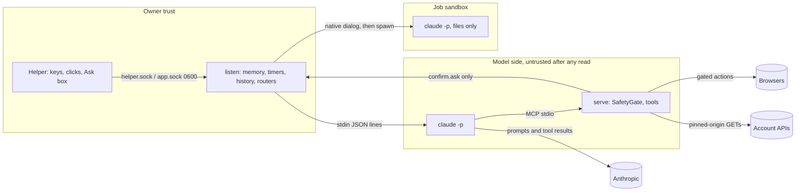
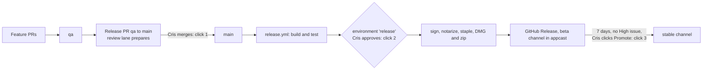
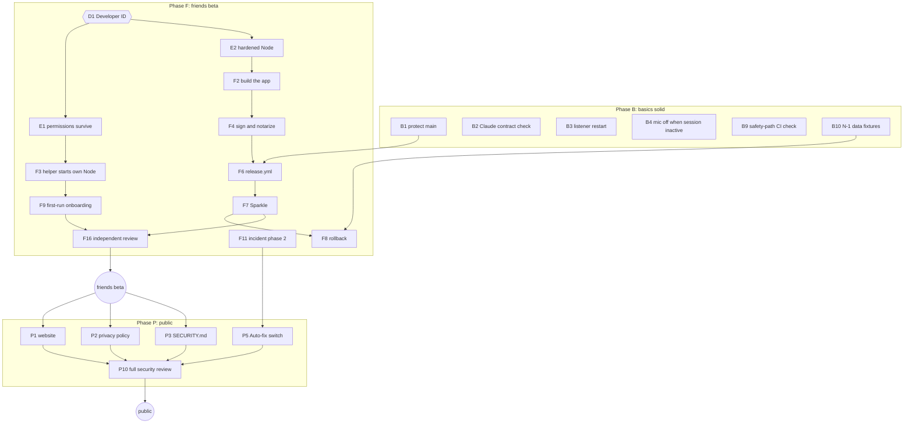

# Stephen: architecture plan, from today to a public release

**Status:** Proposed 2026-11-25 by the dev lane (planning architect). Nothing here is decided until Cris accepts it
on #10. The big choices are in ADR-011 to ADR-015, each "Proposed".
**Goes with:** `docs/SYSTEM-DESIGN-STEPHEN.md` (how Stephen works), `docs/NFR-STEPHEN.md` (targets),
`docs/RELEASE-PLAN.md` (stages), `docs/RELEASE-CHECKLIST.md`, `docs/CI-CD-PROPOSAL.md`, `docs/AGENT-LOOP.md`.
**Rule for this doc:** every claim about today was checked against `qa` at `922775b`. Numbers marked "estimate" are
not measured yet; each has an experiment in section 10.

## Contents

1. Summary in ten lines
2. Architecture today and target
3. Packaging: how a friend gets Stephen
4. Updates: channels, checks, signatures, rollback
5. Release pipeline
6. Observability without content
7. Security and privacy for strangers
8. Platform seam for Windows later
9. Scale of the team
10. Experiments that settle what we are unsure about
11. Roadmap with phases and dependencies
12. Decisions for Cris
13. Task list (for the dev lane to turn into issues)

## 1. Summary in ten lines

1. Keep the process model. It is already right: `listen` holds the owner's trust, `serve` is all the model can call,
   jobs are sandboxed, the helper owns the permissions and the clicks.
2. Change how Stephen reaches a Mac. Today it is built on each Mac from git, which needs Node, git and Apple's
   command line tools, and resets the Mac permissions on every helper rebuild.
3. Target: one signed and notarized `Stephen.app`. The helper is the app. Node, the built code and the small speech
   models are inside. The big speech model downloads on first run, pinned by sha256 like today (ADR-011).
4. Updates through Sparkle 2, with a stable and a beta channel, a signed feed, signed updates, and one-click "go back"
   (ADR-012). The update key is as valuable as the Developer ID key. Signing with one Developer ID keeps the Mac permissions across updates.
5. A release job in GitHub Actions builds, tests, signs and notarizes. Secrets live only in a protected `release`
   environment that waits for Cris's approval click (ADR-013).
6. Incidents: phase 2 is a GitHub workflow that waits 10 minutes, parses the issue strictly, and first only hands it
   to a lane (no agent, no secret); an agent in GitHub comes later, boxed in. Phase 3 is the Auto-fix switch, a repository variable only Cris changes (ADR-014).
7. Strangers change the threat model: shared Macs, other local users, a public repo, a signing key worth stealing.
   Section 7 lists each change and its answer.
8. Windows later: one module per OS concern now, enforced by a test; real interfaces only when Windows work starts
   (ADR-015).
9. The biggest decision: buy the Apple Developer ID **before** the friends beta, not after (section 12, D1). Without
   it a friend needs about 2 GB of Apple tools and loses permissions every update, so the 15-minute setup target
   cannot be met.
10. GitHub does not protect `main` today (the `production` ruleset is disabled; only `qa` has an active ruleset, and
    it requires the checks but not a PR).
    Turning it on is the first task, and it is a settings click for Cris.

## 2. Architecture today and target

### 2.1 Processes today

| Process | Started by | Runs as | Talks over | Holds |
|---|---|---|---|---|
| Stephen Helper (Swift, `~/Applications/Stephen Helper.app`) | The owner, once by `stephen install-helper` | Ad hoc signed app, bundle id `dev.stephen.helper` | `helper.sock`, `app.sock` | Input Monitoring (event tap for F5, Fn+Option, Esc), the menu bar, the Ask box, the window. Mic and Automation for a listener it starts |
| `stephen listen` (Node) | The helper's Start (reads `<home>/run/launch.json`) or Terminal | Node from the repo checkout | `helper.sock` (client), `app.sock` (server), stdio to `claude` | Memory, timers, history, routers, the warm Claude runner, speech models |
| `claude -p` (Claude Code CLI) | The listener, one per conversation | The user's own Claude Code, from PATH or `voice.claudePath` | stream-json on stdio, MCP stdio to `serve` | The model session, the user's Claude sign-in |
| `stephen serve` (Node) | `claude`, from a per-run strict MCP config | Node | MCP stdio; a client of `app.sock` for `confirm.ask` only | The SafetyGate, taint, egress, rate limit, audit log, browser drivers, account tools |
| `stephen jobs _run` supervisor, then `claude -p` for the job | The listener after a native dialog | Detached, scratch environment, Seatbelt sandbox | Files only | One job folder, no MCP, no network for the shell |
| Zen or Chrome | The owner ("Zen for Stephen" app, or Chrome's opt-in debug page) | The user's browser | CDP or WebDriver BiDi on localhost | The user's signed-in sessions |

Sockets and files live in `<home>` = `~/.stephen` (folder 0700, files 0600, sockets 0600, `O_NOFOLLOW`).

### 2.2 Trust boundaries today



The lines that matter: the model can reach only `serve`; `serve` cannot import memory, app, history, timers, connect
or jobs (boundary tests); Allow and Deny are clicks in the helper or a native dialog; jobs get no MCP.

### 2.3 What must change for other people's Macs

| Today (works for Cris) | Problem on a friend's Mac | Target |
|---|---|---|
| Built from a git checkout with `npm install` and `swiftc` | Needs Node, git and Apple's command line tools (about 2 GB). The SDK problem of #248 already broke the build on macOS 27.2 | Prebuilt, signed `Stephen.app` (ADR-011) |
| Helper signed ad hoc (`codesign --sign -`) | macOS ties permissions to the code hash, so every rebuild asks for Input Monitoring again | One Developer ID signature; permissions follow the Team ID, not the build |
| Helper and the listener are two installs (`~/Applications/Stephen Helper.app` plus the repo) | Two things to keep in step; `launch.json` points into a checkout | One app; the helper starts the Node inside its own bundle |
| Listener is started by the helper's Start, and not restarted after a crash | A friend does not know to press Start again | The helper restarts it with a crash-loop limit, and Stephen starts at login (SMAppService) |
| `claude` found on the listener's PATH | A friend may not have Claude Code, or has it somewhere else | First-run check, the official install command shown, `doctor` checks a tested version range |
| Defaults fit Cris (weather Toronto; `DEFAULT_CANVAS_URL` is Cris's school in `src/accounts/canvas.ts`) | Wrong for others | First-run asks for the city; no default Canvas URL; accounts stay opt-in |
| Data in `~/.stephen` | Fine | Keep. Do not move it (a move is a migration that can lose data) |
| Speech models in `<home>/models`, downloaded and sha256-checked | Fine | Keep. The small models (wake word archive 18 MB, VAD 0.6 MB) ship inside the app |

### 2.4 Target process model

The same processes, packaged differently:

```
/Applications/Stephen.app                      (Developer ID, hardened runtime, notarized)
  Contents/MacOS/Stephen                        the helper (Swift): menu bar, Ask box, event tap, window, updater
  Contents/Frameworks/Sparkle.framework         updates (ADR-012)
  Contents/Resources/node/bin/node              official Node 24 binary, re-signed with our ID
  Contents/Resources/app/dist/...               the built TypeScript
  Contents/Resources/app/node_modules/...       production dependencies only (npm ci --omit=dev)
  Contents/Resources/models/kws, vad            small speech models, pinned
~/.stephen/                                     unchanged: config, memory, history, sockets, logs, big models
```

- The helper starts `Contents/Resources/node/bin/node Contents/Resources/app/dist/cli.js listen` from its own
  bundle. **The release build never reads `launch.json`** (a build-time switch, not a setting): any process of the
  user could write that file and get its program run by a notarized app that holds the mic grant. It starts only
  `Bundle.main` paths, checks the Node binary carries our Team ID, and uses a clean environment (no `NODE_OPTIONS`,
  no `DYLD_*`, a fixed PATH plus the found `claude`), with `--disable-sigusr1`. Dev installs keep `launch.json`.
- `claude` stays the user's own install. Stephen never ships Claude Code: it updates itself, it holds the user's
  sign-in, and its license is not ours to redistribute.
- `serve` is still spawned by `claude` from a strict MCP config, now pointing at the bundled Node and `cli.js`.
- Optional for power users: a menu item "Install the stephen command" that links `stephen` into `~/.local/bin`.
  No `sudo`.

What could go wrong, and how we would know:

| Risk | Sign | Answer |
|---|---|---|
| Mic permission is not attributed to the app when Node opens the mic | `pvrecorder` gets silence or an error on a fresh Mac account; `mac-checks` mic line fails | Experiment E2 before any packaging code. Sign Node with the `audio-input` entitlement too |
| Hardened runtime blocks V8 or the native add-ons | Node crashes at start (`EXC_BAD_ACCESS`) or `dlopen` fails for `sherpa-onnx.node` | Experiment E2 starts from `allow-jit` and `allow-unsigned-executable-memory` only (plus `audio-input`, `apple-events`) and adds keys one by one with a written reason. Never `get-task-allow` (notarization refuses it), `allow-dyld-environment-variables` or `disable-library-validation` (every `.node` and `.dylib` is re-signed with our Team ID instead) |
| A friend moves the app | MCP config points at an old path | The listener writes the MCP config per run from `process.execPath`, so voice keeps working; `doctor` flags a stale user-scope registration |

## 3. Packaging: how a friend gets Stephen

### 3.1 Options

Sizes are estimates until experiment E2 measures them. "Setup" means from download to the first spoken command.

| Option | Setup for a friend | Download / disk | Update path | Signing cost | Permissions after update |
|---|---|---|---|---|---|
| A. Today plus `stephen setup` (git, npm, swiftc) | 30 to 60 min: Apple tools are about 2 GB, then 8 steps | About 1.1 GB of `node_modules` with dev tools (measured on Cris's checkout), plus models | `stephen update` (git pull, build) | 0 | Reset whenever the helper is rebuilt |
| B. Homebrew formula that builds from source | Same as A plus Homebrew | Same as A | `brew upgrade` | 0 | Reset (ad hoc) |
| C. **Signed and notarized `Stephen.app` with Node inside, in a DMG** | About 10 min plus the model download | About 90 MB download, 250 MB on disk, 636 MB model on first run (`whisper-small.en`) | In-app updater (Sparkle) | 99 USD a year | **Kept** (same Team ID) |
| D. Homebrew cask that installs the DMG of C | Same as C, but needs Homebrew | Same as C | `brew upgrade --cask` or the in-app updater | Same as C | Kept |
| E. Signed `.pkg` installer | Same as C plus an admin password | Same as C | Sparkle or a new pkg | Same program, plus an Installer certificate | Kept |
| F. Mac App Store | Not possible: the store needs the App Sandbox, and Stephen controls other apps, taps keys and starts `claude` | | | | |

### 3.2 Recommendation

**Option C, then D as a free extra for developers.** One app, dragged to Applications. It is the only option that
meets the 15-minute target and keeps permissions. A `.pkg` (E) adds an admin password and nothing we need. Details
and consequences: `docs/ADR-011-packaging-signed-app.md`.

Design points:
- **Two builds, Apple Silicon and Intel, or Apple Silicon only.** Node has no universal binary, and `sherpa-onnx`
  ships `darwin-arm64` and `darwin-x64` packages. Recommendation: Apple Silicon only for the beta (decision D6).
- **The big speech model is downloaded on first run**, through the code that already pins sha256
  (`src/voice/models.ts`). Shipping it inside would make the download about 700 MB and every update just as big.
- **No dev dependencies inside.** `@sparticuz/chromium` (67 MB), TypeScript and vitest stay out.
- **Node version pinned** in the build script with the sha256 from Node's signed `SHASUMS256.txt`.

What could go wrong: notarization rejects a file (the notary log names it; fix the signing order), the DMG is
quarantined and the friend sees a warning (only if notarization or stapling failed; `spctl -a -vv` in the release
job catches it), the model download fails on a slow network (the downloader works in a temp folder and deletes it on
any error, so a retry is safe; onboarding needs a retry button).

## 4. Updates: channels, checks, signatures, rollback

### 4.1 Recommendation

**Sparkle 2 in the helper.** It is the standard updater for Mac apps outside the App Store, open source (MIT), and it
already solves the hard parts: replacing a running app, EdDSA signatures on the update, checking that the new app is
signed by the same Developer ID, channels, and a "check now" menu item. Writing our own updater would put a new
security-critical piece in our hands. Sparkle is a new dependency, so Cris decides (D4). Details:
`docs/ADR-012-updates-sparkle.md`.

### 4.2 How an update works

| Step | What happens | Checked by |
|---|---|---|
| Check | Once a day and from the menu: GET the appcast (an XML file) from GitHub Pages, deployed only by the release and promote jobs through `actions/deploy-pages` | HTTPS, and the feed itself is EdDSA-signed (`SURequireSignedFeed`) |
| Channel | Each item is stable or beta. Settings: "Get beta updates" (off by default; on for beta friends) | Sparkle channels |
| Download | The signed zip from the GitHub Release | |
| Verify 1 | The zip's EdDSA signature against the public key inside the running app | Sparkle |
| Verify 2 | The new app's code signature is valid (`SUVerifyUpdateBeforeExtraction` on) | Sparkle and macOS |
| Before install | The helper stops the listener (Stop, as today). A running job keeps running (it is detached) | Our code in the helper |
| Install | Sparkle swaps the app and relaunches it | Sparkle |
| After | The helper starts the listener; `doctor` runs; the version is in the latency and incident records | Our code |

**Honest limit:** Sparkle lets a release rotate either the EdDSA key or the code signing identity (not both) when the
other one still matches. So someone holding our EdDSA key may be able to ship an app signed by a different Developer
ID. The two checks are not independent: **the EdDSA key is as valuable as the Developer ID key** and gets the same
care. Experiment E9 tests that exact case before F7 claims anything about it.

**Data rule (N minus 1):** a release may add fields, never change their meaning, and the release before it must still
read every file it writes. Today only the record parsers (`parseLatencyRecord`, `parseIncidentRecord`) drop unknown
fields. `config.json` and its sections are strict (`z.strictObject` in `src/config.ts` and each section's config
file): an unknown key stops Stephen from starting. So **task B11 ships first**: config readers that warn about an
unknown key (in `doctor`) instead of refusing, while still checking the types of known keys. B11 must be in a
release before any release adds a config key. Settings that only the helper uses (beta channel, start at login) live
in the helper's own `UserDefaults`, not in `config.json`. A test keeps fixtures of the last release's files (task
B10). This is what makes "go back" safe.

### 4.3 Rollback

- One app serves every account on the Mac (`/Applications/Stephen.app`). An update or a "go back" changes it for
  everyone, and needs an admin password when the user is not an admin. So rollback goes through the same installer
  path as an update (Sparkle's installer, with its admin prompt), never a file swap done by Node.
- The previous version is kept once per Mac, next to the update cache, not per user.
- Menu: "Go back to the previous version" (and `stephen rollback`, which asks the helper to do it).
- Because both copies carry the same Developer ID, the permissions stay.
- If the new version cannot start at all, the friend downloads the previous DMG from the GitHub Releases page. The
  "First 5 minutes" guide says how.
- Sparkle does not install an older version on its own; a bad release is fixed forward by a new version. Order
  matters: first remove the bad item from the appcast, then tell friends to go back (otherwise Sparkle offers the bad
  version again).

### 4.4 Keeping the Mac permissions

macOS stores each permission with the app's "designated requirement". With an ad hoc signature that is the exact code
hash, so every rebuild is a new app. With a Developer ID it is "this bundle id, signed by this Team ID", so every
update keeps the permission. This is the reason the Developer ID matters for the beta, not only for the public. It is
widely documented, but we have not seen it on Stephen yet: experiment E1 proves it in 15 minutes.

What could go wrong: the bundle id changes (it must stay `dev.stephen.helper` or one chosen id forever; renaming the
app to "Stephen.app" keeps the bundle id), or the Team ID changes (a new Apple account resets everyone). The doctor
already reports permission state; the incident record gets a `permission_lost` code word after an update.

## 5. Release pipeline

### 5.1 Flow



Details: `docs/ADR-013-release-pipeline.md`.

### 5.2 Rules

- **Only Cris merges into `main`.** Today that is a rule in the docs, not a setting: `main` has no active ruleset.
  Task B1 turns on the CI-CD-PROPOSAL step 4 ruleset for `main` (PR required, `linux` and `macos` required, no
  force-push, no deletion, no bypass). Honest limit: agents use Cris's GitHub login, so this guards against mistakes,
  not against an agent acting on purpose. The audit log shows ruleset changes.
- **Versioning:** `0.1.x` for the weekly releases now (one step each), `0.2.0` for the first friends build, `1.0.0`
  for public. The release PR bumps `package.json` and adds the `CHANGELOG.md` entry (a free agent drafts it from the
  PR titles, the review lane checks it). The workflow refuses to build if the tag for that version already exists.
- **The tag** `v<version>` is made by the release job itself, after the build, on the merge commit.
- **Weekly:** unchanged from `docs/RELEASE-CHECKLIST.md`. The only new step: after the merge, Cris approves the
  `release` environment (one click on the run page). A release that should not reach friends (a docs-only week) is
  rejected with one click (a pending run waits up to 30 days, so do not leave it pending).
- **The release job never runs for a PR, a fork, or `qa`.** It runs on `push` to `main` and `workflow_dispatch` on
  `main` only, and the environment's branch rule allows `main` only.

### 5.3 Secrets and where they live

| Secret | What it is for | Where | Who can use it |
|---|---|---|---|
| `MACOS_CERT_P12`, `MACOS_CERT_PASSWORD` | Developer ID Application certificate and key | GitHub environment `release` | Only jobs in `release.yml` on `main`, after Cris's approval |
| `NOTARY_KEY_ID`, `NOTARY_ISSUER_ID`, `NOTARY_KEY_P8` | App Store Connect API key, role "Developer", for `notarytool` | Same | Same |
| `SPARKLE_ED_PRIVATE_KEY` | Signs each update zip | Same | Same |
| `INCIDENT_CLAUDE_KEY` (phase 2) | The incident agent's Claude access | GitHub environment `incident` | Only `incident.yml`, only for allow-listed authors (ADR-014) |

A backup of the certificate and the Sparkle key lives offline with Cris (an encrypted disk image or a password
manager), never in the repo, never on an agent's disk. If the Sparkle key is lost, updates stop and every friend must
download the app again by hand. If it leaks, treat it like a leaked Developer ID key: it may be enough to ship an update (section 4.2). Rotate it at
once with a release signed by our Developer ID, and tell friends.

What could go wrong: notarization takes long or Apple's service is down (the job waits up to 60 minutes, then fails;
re-run later), the certificate expires (Developer ID certificates last 5 years; a calendar note), a macOS runner
change breaks the build (the `macos` CI job sees it first on every PR).

## 6. Observability without content

### 6.1 The telemetry rules (unchanged, repeated because everything below depends on them)

Only counts, times, fixed code words, versions and random ids. Never transcripts, arguments, URLs, hosts, page text,
file names or audio. Parsers drop unknown fields. Local first. Sending is a human action, unless the person turned on
"Report crashes on its own" for themselves.

### 6.2 Incident loop

| Phase | What | Status |
|---|---|---|
| 1 | Content-free incident file (`src/telemetry/incidents.ts`, parts `listen`, `serve`, `helper`, `job`, `other`) and `stephen report`, which sends with the person's own `gh` after "y" | Built (#303) |
| 1b | **New:** friends have no `gh` and often no GitHub account. `stephen report` (and a "Report a problem" menu item) copies the shown text and opens the empty incident issue form; without a GitHub account they send the copied text to Cris. Nothing in a URL | Task F12 |
| 2 | `incident.yml`: event-triggered, 10-minute edit window, strict parse, read-only agent comments its findings | ADR-014, task F11 |
| 3 | Auto-fix switch: repository variable `INCIDENT_AUTOFIX` (`off` by default). `on` lets a second job open a fix PR to `qa` | ADR-014, task P5 |
| 3b | "Report crashes on its own" switch in Settings, per person, off by default | Task P6 |

Phase 2 in short (details in ADR-014). It starts without any secret: the workflow waits, parses, and posts
`from: ci` / `to: dev` on #274 so a lane picks it up. The agent inside GitHub comes when incidents are frequent (D3):
- Trigger: `issues: [opened, edited, labeled]`, only with label `incident`, and only when the issue author is in an
  allow-list kept in the workflow file (Cris and named testers). Everyone else: nothing runs.
- Edit window: `concurrency: incident-<issue number>`, `cancel-in-progress: true`, then `sleep 600`. Each edit
  restarts the wait. A public repo pays nothing for these minutes.
- Strict parse first, in a job with no secret: `scripts/incident-parse.mjs` keeps only lines that match the exact
  format `formatReport` writes and the code words in `INCIDENT_PARTS`, `INCIDENT_CODES` and `INCIDENT_STAGES`. Anything else is dropped.
  The agent never sees the raw issue text, comments, or titles.
- The agent job (later, D3): Claude Code with Read, Grep and Glob limited to `src/` and `docs/` (deny rules for
  `test/fixtures/**`, which holds injection pages on purpose, `/proc/**`, `~/.claude/**` and the runner's temp
  folder), no Bash, no web, no MCP, a turn cap and a cost cap. Its answer has a fixed shape (a cause code word,
  existing file paths, a test name) and a strict output parser posts only what passes. `issues: write` lets the job
  edit any issue, so only the posting step holds it.
- How the lanes see it: a lane acts only on comments by `CrisH2307` (AGENTS.md), so a `github-actions[bot]` comment
  is never an instruction. The workflow adds the label `incident-ready` instead; the lanes list that label at the
  start of a session and read the issue's parsed fields themselves.

What could go wrong: prompt injection through a crafted issue (answered by the allow-list plus the strict parser:
there is no free text left to inject), the agent posts something wrong (it only comments; a person decides), cost
runs away (cap per run, a spend limit on the key, and at most one run per issue per 10 minutes).

### 6.3 Weekly number sheet

Unchanged from `docs/RELEASE-PLAN.md` section 4, with two additions:
- **Friends' numbers.** `stephen report --week` prints one content-free summary (counts and p50/p95 per path, error
  counts by code word, cost per day). A friend sends it when Cris asks. No automatic upload.
- **The version** is on every row, so a change in a number points at a release.

A free agent fills the sheet from the command output; the review lane checks every number against the output.

## 7. Security and privacy for strangers

### 7.1 What changes when people other than Cris use Stephen

| Change | New risk | Answer | How we would know it fails |
|---|---|---|---|
| Shared Macs with several user accounts | Each account runs its own Stephen; with fast user switching a background account's listener may still hear the room | The helper tells the listener to close the mic when its session leaves the console, and to reopen it on return (task B4). Experiment E3 first | Listener log line "mic closed: session inactive"; E3 result |
| Other local users and the browser debug port | "Zen for Stephen" opens a debug port on localhost with no password. Every local user can reach it and drive the signed-in browser | `doctor` warns when the Mac has other user accounts and a debug port is open (task B5). For the beta, when the Mac has other user accounts, the helper refuses to start "Zen for Stephen" with a port and says why (Chrome asks per connection, so it still works). The real fix is the Zen add-on, ADR-009 (native messaging, no port) | Doctor line; ADR-009 build |
| Friends who are not technical | They click Allow to make a box go away | Wording of every Ask box stays plain and specific (already the rule); the first-run guide explains Allow and Deny with one picture | Beta feedback; audit log shows Allow rates per rule (counts only) |
| A public repo | Anyone can read the code, file issues, open PRs, try workflow injection | Already: `pull_request` only, pinned actions, no PR text in `run:`, no secrets in CI. New: incident allow-list, strict parse, environments with required reviewer, "Require approval for all external contributors" on | Audit log; any run started by a non-allow-listed author is a bug |
| Supply chain: npm packages | A bad version of a dependency | `npm ci` from the lockfile only; Dependabot to `qa`; 5 runtime dependencies today; every new one needs Cris's OK (AGENTS.md); `npm audit signatures` in the release job | Dependabot alerts; release job fails |
| Supply chain: Node binary, models | A swapped download | Node pinned by sha256 from the signed `SHASUMS256.txt`; models already pinned by sha256 | Build fails on mismatch |
| Supply chain: our own release | Someone ships a build that is not from `main` | Only `release.yml` on `main` can sign; build provenance attestation (task P7); the appcast lists only releases the job made | `gh attestation verify` on the DMG |
| Signing keys worth stealing | With the Developer ID key, an attacker can sign malware as Cris. With the Sparkle key, they may ship an update to every friend (section 4.2) | Key only in the `release` environment and in Cris's offline backup; no agent ever handles it; Apple can revoke it | GitHub audit log of environment use |
| The update channel | A fake update or a hijacked feed | Signed feed, signed update, valid code signature; both keys guarded the same way (section 4.2) | Sparkle refuses and logs; a test with a wrongly signed zip (task F7) |
| Friends' accounts and data | A bug that leaks one friend's data | Nothing is sent to us; each friend's data stays on their Mac | Privacy policy and `stephen data` list |

Same-user malware stays out of scope (it can already do everything the user can), as `SYSTEM-DESIGN-STEPHEN.md`
section 5 says. The open hardening item (a nonce on `helper.sock`) moves into the friends beta list (task F15).

### 7.2 Everything that leaves the Mac (correction to the NFR)

`docs/NFR-STEPHEN.md` section 2 says nothing leaves the Mac "except the command to Claude and the account APIs". The
code sends a little more. The privacy policy and the data list must say all of it:

| Goes to | What | When | Code |
|---|---|---|---|
| Anthropic, under the person's own Claude account | The command text, the memory block, tool results (page text, email text the model reads), the persona | Every model run | `src/voice/claude.ts`, `src/voice/warm-claude.ts` |
| Google, Canvas, Notion | Read requests with the person's own token | When a tool reads that account | `src/accounts/` |
| ElevenLabs (only if the person set a key and chose that voice) | The reply text to be spoken | Every spoken reply | `src/voice/tts/elevenlabs.ts` |
| Open-Meteo | The configured city's coordinates | "What's the weather", the morning briefing | `src/accounts/weather.ts` |
| GitHub | The person's IP and the app version (update check, model download); an incident report only after the person sends it | Daily check; first run; on "y" | Sparkle (planned), `src/voice/models.ts`, `src/telemetry/report.ts` |
| Websites | Whatever the person asks Stephen to open | On request | Browser tools |
| Us (Cris) | Nothing, unless the person sends a report | | |

### 7.3 Privacy policy: the content

One page, plain words, published with the website and linked from the app's About box:
1. Who we are and how to reach us (the support address, D5).
2. What Stephen keeps on your Mac: the table in `docs/DATA-STORES.md`, with how long and how to delete each.
3. What leaves your Mac: the table in 7.2. Audio never leaves; speech to text runs on your Mac.
4. What goes to Anthropic and that their terms apply to your Claude account.
5. Connected accounts: read-only, tokens in your Keychain, how to disconnect.
6. Crash reports: what is in them (the incident fields), that they are public GitHub issues, and that nothing is sent
   without you, unless you turned on "Report crashes on its own".
7. Updates: the daily check and what it reveals (IP and version).
8. Children: Stephen is not for children under 13 (Claude's own age rules apply).
9. Changes to this policy: announced in the release notes.

## 8. Platform seam for Windows later

Details: `docs/ADR-015-platform-seam.md`. In short: do not build interfaces now (they would have one implementation
each). Do make sure each macOS call lives in one known module, and a test keeps it that way.

| Concern | macOS today (the only files that should call it) | Windows later (idea, not a plan) |
|---|---|---|
| Key listener (F5, chord, Esc) | Helper event tap (`helper/main.swift`, `helper/Core.swift`) over `helper.sock` | A small native tray app with a low-level keyboard hook, same `helper.sock` protocol on a named pipe |
| Secret store | `security` CLI: `src/lib/keychain.ts` (read), `src/connect/keychain-write.ts` (write) | Windows Credential Manager |
| Speaker and chimes | `say` and `afplay`: `src/voice/speech.ts`, `src/voice/tts/say.ts`, `src/voice/tts/player.ts` | Kokoro (already cross-platform through sherpa-onnx) plus a WAV player |
| App launcher, URLs, app quit | `/usr/bin/open`, `osascript`: `src/desktop/system.ts`, `src/zen-launcher.ts`, `src/drivers/macos.ts`, `src/app/cli.ts`, `src/helper/install.ts`, `src/helper/client.ts` | `start`, Shell APIs |
| Volume and media players | JXA through `osascript`: `src/desktop/sound.ts` | Core Audio APIs in the tray app |
| Confirm dialogs and notifications | `osascript`: `src/safety/confirm.ts`, `src/timers/notify.ts`; the Ask box in the helper | The tray app's own dialog. A safety path: `[DEV REVIEW]` |
| File permissions and sockets | 0600/0700, `O_NOFOLLOW`, Unix sockets, peer uid and pid: `src/lib/fs.ts`, `src/lib/private-socket.ts`, the helper | ACLs for the current user, named pipes with a user check. A safety path |
| Other system tools | `osacompile` and `codesign` (`src/zen-launcher.ts`), `codesign`, `plutil`, `ioreg` (`src/desktop/system.ts`), `xcrun` and `codesign` (`src/helper/install.ts`), `xattr` (`src/replay/recorder.ts`), `pgrep` (`src/drivers/macos.ts`). `ps` and `lsof` in `src/lib/process.ts` also exist on Linux | Per tool: most have no Windows twin and their feature stays macOS-only |
| Keep awake during jobs | `caffeinate`: `src/jobs/runner.ts` | `SetThreadExecutionState` |
| Job sandbox | Claude Code's Seatbelt sandbox | Not available: jobs stay off on Windows. They already refuse to start without a sandbox (fail closed) |

What stays macOS-only for good: the Swift helper app itself, Apple's notarization, Seatbelt, and AppleScript-based
media control. What is already portable: the gate, the routers, memory, history, the drivers (CDP and BiDi), speech
to text (sherpa-onnx ships `win-x64`), and the account tools.

## 9. Scale of the team

Today: Cris, the dev lane, the review lane, a UI lane, the OpenCode intern, freellm, and side sessions. It already
works through issues #10, #273 and #274. As the project and the number of agents grow:

| Problem as we grow | Rule |
|---|---|
| Two agents edit the same files | One task, one branch, one worktree; a task lists its allowed files; the dev lane never starts two writers on the same files (already in AGENTS.md). Add a "files" line to each issue the dev lane opens |
| Safety code changed without a dev review | A CI check fails a PR that touches the safety paths (`src/safety/`, `helper/AppConfirm.swift`, memory, timer and job write paths, `src/app/protocol.ts`, `src/app/server.ts`, `.github/workflows/`) without `[DEV REVIEW]` in the title (task B9). It reads the title only through `env:` |
| Cheap models get facts wrong | The model rule below, in every brief. The strong model checks every number |
| Too many open PRs on `qa` | At most 3 active writers at once; a PR older than 7 days without review is closed or picked up at the weekly release |
| Long sessions lose accuracy | The 50% rule (AGENTS.md): hand over at 50% context with a note in the shared notes folder |
| Usage limit | Pause at about 75% of the 5-hour limit: finish the step, update the handover, tell Cris in one line |
| Outside contributors (after public) | `CONTRIBUTING.md`, fork PRs need approval to run CI, no secrets ever reach fork code, a maintainer lane rewrites accepted outside work as its own PR (because merges into `qa` still need the checks) |
| Docs drift from code | Each ADR keeps a Status line; a free agent checks Status lines against `qa` once a month (the onboarding task C), Haiku verifies |

**The model rule (copy into every brief):** use the cheapest model that can do the job. Free agents (OpenCode,
freellm with a healthy model picked by name, never `auto`) do drafts, docs, tests and planned non-safety code from a
precise spec. Haiku does read-only checks. Sonnet does normal coding. Opus does safety code, design and reviews. The
cheaper the model, the more precise the spec: exact files allowed and forbidden, numbered steps, an acceptance test, a
done check. The strong model checks every number a helper writes.

**The usage rule (copy into every brief):** when the 5-hour usage limit is about 75% used, pause. Finish the current
small step, update the handover note, tell Cris in one line, and start nothing new.

## 10. Experiments that settle what we are unsure about

Each is small and comes before the code it protects.

| # | Question | Smallest experiment | Who, time | Blocks |
|---|---|---|---|---|
| E1 | Do permissions survive an update when both builds carry the same Developer ID? | Sign two builds of the helper (versions 0.0.1 and 0.0.2) with the Developer ID. Install 1, grant Input Monitoring and Microphone, replace with 2, check System Settings and `mac-checks` | Cris with the dev lane, 15 min, needs D1 | F3, F7 |
| E2 | Does Node with our native add-ons run under the hardened runtime, pass notarization, and get the mic? | A script that puts Node, `dist` and production `node_modules` in a test bundle, signs every Mach-O with only `allow-jit`, `allow-unsigned-executable-memory`, `audio-input` and `apple-events`, notarizes, then runs `doctor --json` and a 5 s mic test on a fresh macOS user account. Write down the bundle size | Sonnet on the macOS runner, then Cris on the Mac, 1 day | F2, F4 |
| E3 | Does a background user session still get mic audio with fast user switching? | Two accounts, Stephen listening in account A, switch to B, speak, read A's listener log (levels only) | Cris, 10 min | B4 |
| E4 | Does Sparkle's relaunch leave the listener or a job in a bad state? | Update a test build while a long command and a job run | Sonnet plus Cris, 30 min | F7 |
| E5 | Does `concurrency` with `cancel-in-progress` restart the 10-minute wait on each issue edit? | A throwaway workflow on a test label, edit the issue twice | Sonnet, 30 min | F11 |
| E6 | Real setup time | One friend with a stopwatch, every stall written down (already NFR section 7) | Cris, 30 min | Beta gate |
| E7 | What does `total_cost_usd` mean for a friend on a Claude subscription, not an API key? | Compare the daily cost line with the plan's usage page for one day | Cris, 5 min | Daily limit wording |
| E9 | Does Sparkle accept an update with a valid EdDSA signature but another team's code signature? | A test appcast and two test builds: one signed with our ID, one ad hoc or with another ID, both EdDSA-signed with a test key | Sonnet plus Cris, 1 hour | F7 |
| E8 | Does the Claude Code CLI keep the flags Stephen uses? | A weekly CI job: install the latest Claude Code, run `claude --help`, check each flag in `buildClaudeArgs` and `buildJobArgs` | Sonnet, half a day | B2 |

## 11. Roadmap with phases and dependencies



| Phase | Goal | Gate to leave it |
|---|---|---|
| B: basics | The "basics are solid" checklist of `docs/RELEASE-PLAN.md` section 5, plus B1 to B10 here | Checklist green, 3 weekly releases done |
| F: friends beta | A friend installs a signed app in 15 minutes, updates in one click, keeps permissions, reports a crash without `gh` | F16 review has no open High; E6 under 15 minutes; then 2 weeks of beta with no High issue |
| P: public | Anyone can download it | Website, privacy policy, SECURITY.md, license notices, P10 review with no open High |
| W: Windows | Later. Starts with ADR-015 step 2 | Cris decides after public |

Rough time, if the lanes keep today's pace (an estimate, not a promise): phase B 2 to 3 weeks, phase F 3 to 4 weeks
after D1, phase P 2 to 3 weeks after the beta gate.

## 12. Decisions for Cris

Only goals, requirements, strategy and money. Everything else the lanes decide and report on #10.

| # | Decision | Options | Trade-off in plain words | Recommendation |
|---|---|---|---|---|
| D1 | **When to join the Apple Developer Program (99 USD a year)** | a) Now, before the friends beta. b) After the beta, as you said on 2026-11-23. c) Never; friends build from git | (b) and (c) mean every friend installs about 2 GB of Apple tools, setup takes 30 to 60 minutes, the build can break on a new macOS (#248), and permissions reset at every update. (a) costs 99 USD a year and about one hour of your time for the sign-up and the certificates | **a) Now.** It is the one change that makes the 15-minute setup and "permissions kept" possible. This changes your earlier answer, so please confirm |
| D2 | **Friends need their own paid Claude plan** | a) Yes, say so in the invite. b) Look for a way to pay for them | Claude Code needs a Claude Pro or Max plan or an API account. We do not hold anyone's money today; paying for friends means an API key we manage, a bill, and a new server | **a) Yes.** Each friend uses their own plan; the daily limit protects them |
| D3 | **Incident agent: who pays and how much** | a) An Anthropic API key with a monthly spend limit (for example 20 USD) in the `incident` environment. b) Your Claude subscription token. c) No agent in GitHub; the workflow labels the issue `incident-ready` and the lanes pick it up | (a) is separate from your own use and capped. (b) costs nothing extra but shares your usage limit with your own work. (c) is free but slower (hours, not minutes) | **Start with c) during the friends beta**, move to a) when incident issues come more than a few times a week |
| D4 | **Sparkle as a new dependency for updates** | a) Sparkle 2. b) Our own updater. c) No in-app updates; friends download each version | (a) is the tested standard, MIT licensed, and adds one framework. (b) is security code we would have to write, review and maintain. (c) means friends stay on old versions | **a) Sparkle 2** |
| D5 | **Website, domain and support** | a) GitHub Pages at `crish2307.github.io/stephen`, GitHub Discussions for support, GitHub private vulnerability reports for security. b) The same plus your own domain (about 15 USD a year) | (a) is free and enough for friends. A domain looks more serious for the public, and you can add it later without breaking links if the app's update address points to a domain we control from day one | **a) for the beta; b) before public.** If you buy the domain anyway, buy it before the first friends build, so the update address never changes |
| D6 | **Which Macs to support** | a) Apple Silicon only, macOS 14 and up. b) Also Intel Macs | Intel doubles the builds and the hand checks, and you cannot test Intel yourself | **a) for the beta.** Ask the friends what they have first |
| D7 | **Your clicks per release** | a) Three clicks: merge the release PR, approve signing, promote beta to stable after 7 days. b) Two clicks: merge, approve; stable at once | (a) gives friends on beta a week to find problems before everyone gets the build. (b) is faster but every user gets every mistake | **a) Three clicks**, about 2 minutes a week on top of today's Mac checks |
| D8 | **"Report crashes on its own" for friends** | a) Off by default, each friend's choice (as planned). b) On by default in the beta | On by default finds more crashes. Off by default is the privacy promise. The report has no content either way | **a) Off by default**, and ask friends in the invite to turn it on |

Still open from `docs/RELEASE-PLAN.md` (not repeated here): the weekly release day and the friends beta date.

## 13. Task list

For the dev lane to turn into issues, one issue per row. **Size:** S under half a day, M one to two days, L three days
or more of agent time. **Model:** the cheapest that can do it (section 9). **Safety:** `[DEV REVIEW]` means the
title tag, a dev-lane review and an independent review before merge. Every brief built from a row carries the model
rule and the usage rule from section 9.

### Phase B: basics solid

| ID | Task | Files or area | Size | Model | Safety | Acceptance test |
|---|---|---|---|---|---|---|
| B1 | Protect `main`: an active ruleset with a `pull_request` rule, `linux` and `macos` required, no force-push, no deletion, no bypass. Decide if `qa` gets the `pull_request` rule too (today it has only the checks, no deletion and no force-push) | GitHub settings (Cris's click); the dev lane writes the exact steps | S | Haiku writes steps | No | `gh api repos/CrisH2307/stephen/rulesets` shows a `main` ruleset `active` with `pull_request`; a test push to `main` is refused |
| B2 | Weekly Claude Code contract workflow. The version range (`TESTED_CLAUDE_MIN`, `TESTED_CLAUDE_MAX`, `claudeVersionCheck` in `src/voice/claude.ts`) and the flag check (`checkClaudeFlags`, `test/voice/claude-contract.test.ts`) already exist; the workflow runs `checkClaudeFlags` on the live `claude --help` of the latest release (E8) | New `.github/workflows/claude-contract.yml`, a tiny script calling `checkClaudeFlags` | S | Sonnet | Workflow change: Cris OKs the schedule trigger | The workflow fails on a fake `--help` text with one flag removed, passes on today's |
| B3 | Helper restarts a crashed listener, at most 3 times in 5 minutes, then shows "Stephen stopped, press Start"; each crash writes an incident | `helper/StephenControl.swift`, `src/telemetry/incidents.ts` callers | M | Sonnet, Opus reviews | **[DEV REVIEW]** (what runs with the mic grant; helper PR: Mac click check) | `kill -9` of the listener: back within 10 s; 4th crash in 5 min: stays stopped with the message; `stephen report` shows the crashes |
| B4 | Mic off while the Mac session is not active (fast user switching), after E3 | `helper/main.swift` (session notifications), `src/helper/protocol.ts`, `src/voice/listener.ts` | M | Opus | **[DEV REVIEW]** (privacy, helper protocol) | Unit test of the new protocol message; Mac check: switch user, log says mic closed within 2 s, back on return |
| B5 | Shared Macs: `doctor` warns, and the helper refuses to start "Zen for Stephen" with a debug port when other user accounts exist (until ADR-009) | `src/cli.ts` doctor, `src/zen-launcher.ts`, a small check module | S | Sonnet, Opus reviews | **[DEV REVIEW]** | Unit tests with a fake user list: one account starts, two accounts refuse with a reason |
| B6 | `stephen data`: list each store, size, retention, how to delete (from `docs/DATA-STORES.md`) | New `src/app/data-cli.ts` or `src/cli.ts` case, tests | S | Free agent (OpenCode) from a precise spec | No | Test: every row of DATA-STORES.md appears; sizes come from the real files |
| B7 | Correct "what leaves the Mac" in `docs/NFR-STEPHEN.md` section 2 and add the table of section 7.2 to `docs/DATA-STORES.md` | Docs only | S | Free agent draft, Haiku checks each row against the code | No | Each row cites a file that exists and does what it says |
| B8 | Move Cris-specific defaults out: no default Canvas URL (`DEFAULT_CANVAS_URL` in `src/accounts/canvas.ts`; ask instead), weather city asked at first run (Toronto stays only as `DEFAULT_WEATHER`), neutral comments and tool text (`src/accounts/index.ts` says "Toronto by default") | `src/accounts/`, `src/memory/intent.ts` comment, `src/eval/dry-server.ts` | S | Free agent from a precise spec | No | Tests pass; `rg -i "ontariotechu|toronto" src` hits only `DEFAULT_WEATHER` |
| B9 | CI check: a PR touching safety paths needs `[DEV REVIEW]` in its title | New `scripts/safety-paths.mjs`, a step in `.github/workflows/ci.yml` (title through `env:` only) | S | Sonnet, Opus reviews | **[DEV REVIEW]** (workflow change: Cris OKs) | A test PR touching `src/safety/` without the tag fails; with the tag passes; title text never reaches `run:` |
| B10 | N minus 1 data fixtures: save today's files (`config.json`, `memory.json`, `timers.json`, a history line, a latency line, an incident line, a job state) and a test that the current code reads them, plus a config with an extra unknown key | `test/fixtures/v0.1/`, `test/compat.test.ts` | M | Free agent from a precise spec, Sonnet reviews | No | The test passes; deleting a parser field makes it fail; after B11, the extra-key config loads with a warning |
| B11 | Tolerant config readers: an unknown key in `config.json` or a section is a `doctor` warning, not a start failure; known keys keep strict types. Must ship before any release adds a config key | `src/config.ts` and the section config files (`src/voice/config.ts`, `src/voice/tts/config.ts`, `src/memory/config.ts`, `src/history/config.ts`, `src/jobs/config.ts`, `src/app/config.ts`, `src/desktop/config.ts`) | M | Sonnet, Opus reviews | **[DEV REVIEW]** (config decides safety settings such as `safety.confirm`) | A config with an unknown key starts and `doctor` names the key; a known key with a wrong type still refuses; safety keys keep their checks |

### Phase F: friends beta

| ID | Task | Files or area | Size | Model | Safety | Acceptance test |
|---|---|---|---|---|---|---|
| F1 | Apple Developer Program sign-up, Developer ID Application certificate, App Store Connect API key, offline backup | Cris (D1); dev lane writes the steps | S | Haiku writes steps | No | `security find-identity -p codesigning` on a test run shows "Developer ID Application" |
| F1b | Experiments E1 and E2 | Scratch scripts, results in `docs/research/` | M | Sonnet, Cris on the Mac | No | Written results with numbers (bundle size, permission state after update) |
| F2 | `scripts/build-app.mjs`: build `dist`, `npm ci --omit=dev` into a staging folder, fetch Node by pinned version and sha256, compile the helper, assemble `Stephen.app`; drop the repo `.env` lookup in the app build (`REPO_ROOT` points inside the bundle); remove or replace the old `~/Applications/Stephen Helper.app` on first run (one permission re-grant expected, said in the guide) | New script, `helper/Info.plist` (name, `SUFeedURL`, `SUPublicEDKey`), `src/accounts/secrets.ts` | L | Sonnet | No | On the macOS runner: the app's Node runs `cli.js --version` and `doctor --json`; size within 20% of E2 |
| F3 | The helper starts the listener from its own bundle. Release build: never reads `launch.json` (build-time switch), only `Bundle.main` paths, checks Node's Team ID, clean environment (no `NODE_OPTIONS`, no `DYLD_*`, fixed PATH plus the found `claude`), `--disable-sigusr1`. Dev build keeps `launch.json` | `helper/StephenControl.swift`, `src/app/control.ts` | M | Opus | **[DEV REVIEW]** (decides what program runs with the mic permission) | Unit tests for path choice; a planted `launch.json` and `NODE_OPTIONS` are ignored by the release build; Mac check: fresh account, Start works without Terminal |
| F4 | `scripts/sign-app.sh`: sign every Mach-O inside out with hardened runtime and the minimal entitlements from E2, notarize with `notarytool`, staple, build DMG and zip | New script, `helper/Stephen.entitlements` | M | Sonnet, Opus reviews | **[DEV REVIEW]** (entitlements set the runtime's protections) | `codesign --verify --deep --strict` and `spctl -a -t exec -vv` pass; `codesign -d --entitlements` shows no `get-task-allow`, `allow-dyld-environment-variables` or `disable-library-validation`; DMG opens on a fresh Mac with no warning |
| F5 | Login item through SMAppService, a Settings switch "Start Stephen at login" | `helper/SettingsPage.swift`, `helper/main.swift` | S | Sonnet | No | Mac check: log out and in, Stephen is in the menu bar |
| F6 | `.github/workflows/release.yml` and the `release` environment (required reviewer Cris, branch `main` only), per ADR-013: job 2 runs no `npm`, no dependency code, no cache; `concurrency: release`; permissions written per job; Pages deploy through `actions/deploy-pages` | New workflow, repo settings (Pages on) | L | Opus | **[DEV REVIEW]** (secrets, CI trigger: Cris OKs) | A dry run signs nothing without approval; job 2 never starts for a PR; two pending runs cannot both sign; with approval: a draft release with DMG, zip, checksums and a signed appcast item |
| F7 | Sparkle 2 in the helper: signed feed (`SURequireSignedFeed`), `SUVerifyUpdateBeforeExtraction`, channels, "Check for updates", "Get beta updates" (in `UserDefaults`), stop the listener before install (E4) | `helper/`, appcast generation in `release.yml` | L | Sonnet, Opus reviews | **[DEV REVIEW]** (update verification is a trust boundary) | 0.2.0 updates to 0.2.1 from a test appcast; permissions kept (E1); a zip with a wrong EdDSA key is refused; a tampered feed is refused; the E9 case is written down with its result |
| F8 | Rollback through the installer path: the previous version kept once per Mac, "Go back" menu item, `stephen rollback` asks the helper (no Node file swap) | `helper/`, `src/cli.ts` | M | Sonnet, Opus reviews | **[DEV REVIEW]** (replaces the signed app) | After an update, go back restores the old version; B10 fixtures and a B11-era config still load; permissions kept; a non-admin user gets the admin prompt; a shared-Mac case is written down |
| F9 | First-run onboarding in the app: Claude Code present and signed in (show the official install command, never run a script for them), model download with progress and retry, permission walkthrough, city | `helper/` (UI lane), `src/app/` requests that already exist where possible | L | Sonnet (UI lane) | No, unless it adds an app.sock request: then **[DEV REVIEW]** | E6: a friend reaches the first spoken command in 15 minutes |
| F10 | "First 5 minutes" guide | `docs/FIRST-5-MINUTES.md` | S | Free agent draft, Haiku checks against the app | No | Every step matches the app; no step needs Terminal |
| F11 | Incident phase 2: `incident.yml` and `scripts/incident-parse.mjs`, per ADR-014. First without a secret (label `incident-ready`); the agent and the `incident` environment only after D3, with path limits and an output parser | New workflow and script | L | Opus | **[DEV REVIEW]** (public repo trigger, untrusted input) | E5 passes; an issue by a non-allow-listed author runs nothing; a crafted body with free text parses to nothing; with the agent: a read of `test/fixtures/` or `/proc` is denied, and a free-text answer is not posted |
| F12 | `stephen report` without `gh`: copy the shown text, open the empty incident form; "Report a problem" menu item | `src/telemetry/report.ts`, `helper/` menu | S | Sonnet, Opus reviews the "nothing in a URL" rule | No | Tests: no `gh` means copy plus open; the opened URL has no query and no fragment |
| F13 | `stephen report --week`: the content-free weekly summary | `src/telemetry/cli.ts` | S | Free agent from a precise spec | No | Test: the output has only numbers, code words, versions and dates (a test with planted words in the records) |
| F14 | Release notes and appcast text from `CHANGELOG.md` | `scripts/`, `release.yml` step | S | Free agent | No | The appcast item shows the release's changelog section |
| F15 | Nonce on `helper.sock` (the open hardening item) | `helper/`, `src/helper/` | M | Opus | **[DEV REVIEW]** | A client without the nonce is refused (test), the helper protocol fixtures updated |
| F16 | Independent review of packaging, updater, release workflow, onboarding | Read-only | M | Opus, fresh reviewer | Review | A `docs/REVIEW-11.md` with no open High |

### Phase P: public

| ID | Task | Files or area | Size | Model | Safety | Acceptance test |
|---|---|---|---|---|---|---|
| P1 | Website: download, guide, privacy policy, security contact (start from `docs/site/`). The appcast lives on the same Pages site, deployed only by the release job | `docs/site/`, GitHub Pages | M | Free agent draft, Sonnet builds, Opus reviews anything that touches the feed | **[DEV REVIEW]** if it changes the Pages deploy | Pages live; the download link is the notarized DMG; no tracking script; the feed is not writable by the site build |
| P2 | Privacy policy from section 7.3 | `docs/PRIVACY.md`, the site | S | Free agent draft, Opus checks every claim against the code | No | Every row of 7.2 is in it; reviewer sign-off |
| P3 | `SECURITY.md`, GitHub private vulnerability reporting on | Repo root, settings (Cris) | S | Free agent | No | The Security tab shows the policy and the report button |
| P4 | Third-party notices: Node, npm packages, models (Whisper, Silero VAD, Parakeet, Moonshine, Kokoro, the keyword model: check each license, some need attribution) | `THIRD-PARTY-NOTICES.md`, inside the app | M | Haiku collects, free agent writes, Opus checks | No | Every file inside the app has a license entry |
| P5 | Auto-fix switch: `INCIDENT_AUTOFIX` variable, a second job that opens a fix PR to `qa` | `incident.yml` | M | Opus | **[DEV REVIEW]** | With the variable `off`, no PR ever; with `on`, a PR to `qa` with a test and `[DEV REVIEW]` if it touches safety paths |
| P6 | "Report crashes on its own" switch | `src/telemetry/`, `helper/SettingsPage.swift` | M | Sonnet | **[DEV REVIEW]** (sends data without a click) | Off by default; when on, sends only parsed incident fields |
| P7 | Build provenance attestation and an SBOM in `release.yml` | `release.yml` | S | Sonnet | New action: Cris OKs | `gh attestation verify` passes on the DMG |
| P8 | Homebrew cask in a tap (`CrisH2307/homebrew-stephen`) | New repo | S | Free agent | No | `brew install --cask` installs the notarized app |
| P9 | `CONTRIBUTING.md`, "Require approval for all external contributors" | Docs, settings | S | Free agent | No | Setting on; doc reviewed |
| P10 | Full independent security review of the whole surface | Read-only | L | Opus, fresh reviewer | Review | `docs/REVIEW-12.md`, no open High |

### Phase W: Windows (later)

| ID | Task | Files or area | Size | Model | Safety | Acceptance test |
|---|---|---|---|---|---|---|
| W0 | Platform call test: only the files in section 8 may run the macOS programs listed in ADR-015 (`osascript`, `osacompile`, `security`, `say`, `afplay`, `open`, `caffeinate`, `codesign`, `plutil`, `ioreg`, `xcrun`, `xattr`, `pgrep`); matches the program passed to `execFile` and `spawn`, not comments | New `test/platform-calls.test.ts` | S | Free agent from a precise spec | No | Passes on `qa`; fails when another file adds such a call |
| W1 | ADR-015 step 2: interfaces with a macOS and a Windows implementation | `src/platform/` | L | Opus design, Sonnet code | **[DEV REVIEW]** for the secret store, dialogs and file permissions | Starts only after Cris's go |
