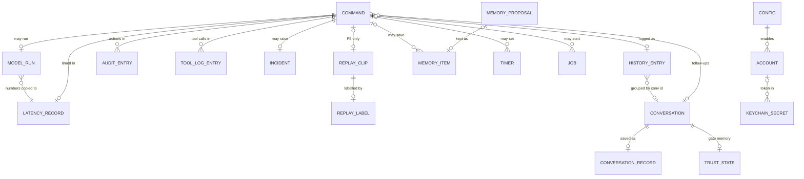

# 3. Data model

Step three of the interview answer: what Stephen stores, where, for how long, and who may write it.
Describes `qa` at commit `5fae967` (2026-11-25). Line references are for commit `5fae967`.
Terms: see [README.md](README.md#words-used-on-these-pages) and the glossary, `docs/guide/GLOSSARY.md`.

## 3.1 Why there is no database

The data is small, local and per person. It sits in one folder, `<home>`, which is `~/.stephen` by default
(`src/config.ts:232-241`). Most stores are JSON files (one object) or JSONL files (one JSON object per line, so each
new record is one appended line). Account secrets sit in the macOS Keychain, the Mac's built-in password store.

A database would add a process to run, a schema to migrate and a second copy of the data. Stephen does not need that:

- Most stores have a cap. Memory holds 30 items (`src/memory/store.ts:31`). Timers hold 20 (`src/timers/store.ts:15`).
  Each day's history file takes no more lines once it reaches 5 MB (`src/history/store.ts:98`). The audit log rotates
  at 5 MB and keeps 3 old files (`src/safety/audit.ts:11-12`). Uncapped: job state, Claude Code transcripts, config,
  Keychain secrets and job output folders.
- Each file has a named set of writers, listed in 3.3. Most files have one writer. Some have several: `audit.log`
  (the listener, the tool server, the job runner and the owner CLIs), job state (the listener at
  `src/jobs/manager.ts:621` and the runner at `src/jobs/runner.ts:143`), and `memory.json` (the listener and
  `stephen memory`, `src/memory/cli.ts:88`). That is why memory has a lock (3.4). The only file lock among the data
  stores is on memory. The serve instance lock (`run/serve-<id>.lock`, `src/server/instance.ts:43-64`) is not a data store.
- Nothing queries across files. A reader loads one file, or one day, at a time.

## 3.2 Entities

Each entity gives its type, storage, lifetime, writer and reader in its section below. The **Holds your words** mark
is in those section texts, not in the diagram. It marks the entities that can contain what you said or asked for.
The audit log and tool log are covered in 3.3 and 3.5.

Notes on the diagram:

- `conversation.json` is absent when follow-ups are off or after the conversation ends
  (`src/voice/conversation.ts:211-217, 236-237`), so a conversation has zero or one record.
- A one-shot command has no conversation (`src/history/store.ts:64`), so a command has zero or one conversation.
- The ElevenLabs key (`src/voice/tts/keys.ts:14`) and the Google sign-in client secret (`src/accounts/secrets.ts:25`)
  are Keychain items that belong to no single account. So a Keychain secret has zero or one account.

### 3.2.1 Command

One request: a wake word, F5, the app, the command line or the phone. It gets an id when it starts.

- Type: `LATENCY_TRIGGERS` (`src/telemetry/latency.ts:21`), `MEMORY_SOURCES` (`src/memory/store.ts:39`), trust
  `trusted | wake | phone` (`src/voice/assistant.ts:18`). Id: `h_` plus 16 hex (`src/history/store.ts:112-113`).
- Key fields: `id`, `source`, `trust`, `route` (memory, timer, job or model). No file of its own; the id joins the records below.
- Local routers run before the model (`src/voice/assistant.ts:298-300`). **Holds your words:** no.

### 3.2.2 Model run and latency record

A model run is one call to Claude. It is not stored by itself. Its timing and cost are copied into one latency record per trigger.

- Types: `RunOptions` (`src/voice/claude.ts:235-247`), `ClaudeOutcome` (`:452-468`). Record: `LatencyRecord`, version 1
  (`src/telemetry/latency.ts:49-89`).
- Fields: `id`, `trigger`, `route`, `outcome`, `stages` (milliseconds), `modelMs`, `toolMs`, `costUsd`, `tools` (at most 12 names).
- Stored in `<home>/telemetry/latency-YYYY-MM-DD.jsonl` (`:309-314`). Lifetime 30 days (`:142`). Each day's file takes
  no more lines once it reaches 4 MB (`src/telemetry/latency.ts:144`). Written by `LatencyMonitor.end()`.
  Read by the telemetry CLI. **Holds your words:** no, numbers and tool names only.

### 3.2.3 History entry and conversation

A history entry is one finished command in your log. A conversation groups the follow-ups that belong together.

- Type: `HistoryEntry` (`src/history/store.ts:48-74`). Fields: `id`, `ts`, `source`, `said` (at most 2000 characters),
  `reply` (at most 4000), `outcome`, `tools` (names and times, no arguments), `followUp` (true for a follow-up),
  `ms` (total time), `turns` (Claude turns used), `steps` (the action chain lines the command showed, each at most
  160 characters, `src/history/store.ts:37-45`; these can hold your words), `editOf` (on the first line of an edited
  branch only: the earlier message it replaces), and `conv` (`c_` plus 16 hex; absent on older lines).
- Stored in `<home>/history/YYYY-MM-DD.jsonl` (`:106-109`). Lifetime: `retentionDays`, default 7, 0 to 30; 0 is off
  (`src/history/config.ts:9-13`). Written when a command ends (`src/voice/command-log.ts:114-140`). Read by the app and `stephen history`.
- Claude Code keeps the full prompt, tool results and replies in its own transcript (`src/voice/transcripts.ts:6`).
  Stephen deletes it when the conversation ends or history is purged. **Holds your words:** yes, both.

### 3.2.4 Memory item

A fact you asked Stephen to remember. Claude reads it as labelled text in the persona, never as instructions.

- Type: `MemoryItem` (`src/memory/store.ts:50-60`). Fields: `id` (`m` plus a number), `text` (1 to 200 characters),
  `source`, `origin` (`'you'` when kept from a proposal), timestamps.
- Stored in `<home>/memory.json` (`src/memory/store.ts:28-29`). Lifetime: until forgotten or cleared. No time purge.
- Written only by `MemoryStore`, called from the voice router, the app and `stephen memory` (`src/memory/cli.ts:88`).
  Read by the persona builder (`src/voice/claude.ts:160-168`). The phone gets none (`:174-176`).
  **Holds your words:** yes. Secret-looking text is refused (`src/memory/store.ts:102-148`).

### 3.2.5 Memory proposal

A memory the app suggests. Nothing is saved until you press Keep.

- Type: `MemoryProposal` (`src/memory/proposals.ts:26-33`). Fields: `id` (`p` plus a number), `text`, `origin`, `createdAt`.
- Stored in `<home>/memory-proposals.json`, cap 20, oldest dropped (`:24`, `:82`). Lifetime: until Keep or Skip (`:88-94`).
- Written only by the listener, from the app (`src/app/server.ts:598`). No model tool reaches it.
  **Holds your words:** yes.

### 3.2.6 Timer and reminder

A countdown or a reminder that the listener speaks when it is due.

- Type: `TimerItem` (`src/timers/store.ts:21-32`). Fields: `id` (`t` plus a number), `kind` (`timer` or `reminder`),
  `text` (at most 200 characters), `dueAt`, `createdAt`.
- Stored in `<home>/timers.json`, cap 20 (`src/timers/store.ts:14-15`). Lifetime: until it fires or you cancel it. An item
  more than 12 hours late is dropped silently (`:18`, `:157-161`).
- Written by `src/timers/router.ts` in the listener (`src/voice/index.ts:588`). The phone is refused (`:88`). One process
  owns the file, so there is no lock. **Holds your words:** yes, the reminder text.

### 3.2.7 Job

A longer task that Claude runs in the background after you press Start.

- Type: `JobState` (`src/jobs/state.ts:26-68`). Statuses: `queued`, `running`, `done`, `failed`, `stopped`, `timeout`
  (`:17`). Fields: `id`, `task` (your words, at most 600 characters), `status`, `startedAt`, `endedAt`, `costUsd`, `summary`
  (Claude's result, untrusted), `error`.
- Stored in `<home>/jobs/<id>.json` with a meta folder `<home>/jobs/<id>/` (`:71-72`). The output folder
  `~/Stephen Jobs/<id>/` is separate and stays (`src/jobs/config.ts:21`).
- Lifetime: `keepDays`, default 30, after the job ends (`src/jobs/config.ts:33`). The state and meta folder are then deleted.
- Written by the listener (`queued`, `src/jobs/manager.ts:621`) and the job's supervisor (`running` and the final state,
  `src/jobs/runner.ts:143`, `:162-163`). The model cannot start a job: no job tool exists, and `src/jobs/` is unreachable
  from model-side code (`test/memory/boundary.test.ts:30`, `:111-114`). **Holds your words:** yes.

### 3.2.8 Account

The accounts Stephen may read (Canvas, calendar, Notion, Gmail, weather), and where their secrets are kept.

- Config section `accounts` (`src/accounts/config.ts:15-47`). Secrets are Keychain items (`src/accounts/secrets.ts:19-25`,
  for example `stephen-canvas` and `stephen-gmail-<label>`, `:157-159`). A `.env` file is a fallback for older setups (`:4-8`).
- Lifetime: until removed. Two commands remove some of them, `stephen disconnect gmail <label>` and `stephen voice-key delete`.
- Written only by owner commands (`src/connect/keychain-write.ts:2`). **Holds your words:** no, tokens and keys only.

### 3.2.9 Incident

A small record of a failure. It has no free text field, so it cannot hold your words.

- Type: `IncidentRecord` (`src/telemetry/incidents.ts:49-69`). Fields: `id`, `ts`, `stephen` (version), `part`, `code`
  (closed list, `:37-42`), `stage`, timings.
- Stored in `<home>/incidents/YYYY-MM-DD.jsonl`. Cap 1 MB per day, set at `src/telemetry/incidents.ts:84` and enforced
  on each write (`:173`). Lifetime 30 days (`:82`).
- Written by `recordIncident` (`:154-177`). Read by `stephen report`, which asks you to type y before anything goes to
  GitHub (`src/telemetry/report.ts:93`).

### 3.2.10 Config

Your settings, in one JSON file, checked by a strict schema.

- Type: `UserConfigSchema` (`src/config.ts:91-149`). Unknown top-level keys fail the load. Sections include `safety`,
  `voice` (`followUpWindowSec` default 180, `dailyLimit` default 1 USD), `memory`, `history`, `jobs`, `accounts`, `app`.
- Stored in `<home>/config.json` (`src/config.ts:253-258`). Lifetime: until you edit it. Written by you, or by the app
  through `updateConfigSection`, which writes atomically (`src/config-write.ts:11-21`). **Holds your words:** no.

### 3.2.11 Conversation trust state

A follow-up is a second command in the same Claude conversation. Two small files make that possible. They also keep the
safety gate's memory of what private data the conversation has read.

- Gate state, `<home>/voice/conversation-state.json` (`src/safety/session-state.ts:28`): private-read markers and approved
  host names. Written by the tool server (`:122-144`).
- Follow-up record, `<home>/voice/conversation.json` (`src/voice/conversation.ts:29`): `sessionId`, `endedAt`, `memory`
  (a hash), `trust`. Written by the listener (`:185-196`). It resumes only with the same trust, inside the window and
  with the same memory hash (`:127-132`).
- Lifetime, in plain words: both files are removed when the conversation ends (`end()`, `:211-217`), and when a new
  command starts outside the window (`begin()`, `:116-121`). The window check runs in memory (`armWindow`,
  `src/voice/conversation.ts:551-557`), so after a one-shot command the files can stay on disk until the next command
  or until the listener stops.
- **Holds your words:** no. The session id leads to the transcript, which does (3.2.3).

### 3.2.12 Replay clip and label

An optional recording of an F5 command, so you can check how well Stephen heard it. It is off by default.

- Switch `voice.replay.enabled`, default false (`src/voice/config.ts:194`). Only F5 records (`src/replay/recorder.ts:47`).
- Files in `<home>/replay/`: `<id>.wav`, `<id>.json` (a transcript of at most 2000 characters) and `<id>.label.json`
  (`{v, code, at}`, with code `ok`, `wrong_trigger`, `wrong_heard`, `wrong_understood` or `wrong_action`, `:53-81`).
- Caps: 30 days (`:36`), 100 clips (`:40`), 50 MB of audio per day (`:45`). Written by the listener (`:345-371`, `:431-439`).
- **Holds your words:** yes, the audio and the transcript. The label holds only a code and a time.

## 3.3 Who may write what

| Store | Listener | Tool server | Helper app | Job runner | Model |
|---|---|---|---|---|---|
| Memory items and proposals | Writes | No | No | No | No |
| Timers | Writes | No | No | No | No |
| History, latency, incidents, replay | Writes | No | No | No | No |
| Follow-up record | Writes | No | No | No | No |
| Gate state (trust) | Reads, deletes at conversation end (`src/voice/conversation.ts:236-237`) | Writes | No | No | No |
| Audit log | Writes (memory changes, job start and stop, owner CLIs `src/memory/cli.ts`, `src/jobs/cli.ts`) | Writes (gate decisions) | No | Writes (job end, `src/jobs/runner.ts:12,19`) | No |
| Tool log | Empties before each run (`src/voice/command-log.ts:93`) | Writes (names and times) | No | No | No |
| Jobs | Writes `queued` | No | No | Writes `running` and the final state | No |
| Config | Writes (app, owner CLI) | No | No | No | No |
| Keychain secrets | Owner CLI only | No | No | No | No |
| Helper's own log and pid file | No | No | Writes | No | No |

"Writes" for the listener includes owner commands you type yourself, such as `stephen memory`.

How "the model never writes memory, timers or jobs" is enforced:

1. Import boundaries. `test/memory/boundary.test.ts` fails if `src/memory/`, `src/history/`, `src/timers/`,
   `src/jobs/`, `src/connect/` or `src/app/` is reachable from model-side code, by direct or runtime import
   (lines 19-36 list the boundaries, 91-99 run the checks).
2. Tool names. No tool name matches `/remember|memor|forget/i` (`:45`, `:177`), and no job tool exists (`:111-114`).
3. Channel rules. The phone refuses memory changes and timers (`src/voice/memory-router.ts:79`, `src/timers/router.ts:88`).
   A wake-word save asks you first (`src/voice/memory-router.ts:98-109`).

Caveat: the boundary test scans the import graph. It shows what code can load, not what it does at run time.
Open safety items are in [INJECTION-COVERAGE.md](../INJECTION-COVERAGE.md).

## 3.4 Write safety

- Atomic write: `writePrivateFileAtomicSync` writes a temp file in the same folder, then renames it over the target
  (`src/lib/fs.ts:34-54`). A reader sees the old file or the new one, never half of one.
- Modes: files 0600, folders 0700 (`src/lib/fs.ts:153-167`). The temp file is made 0600 before the rename
  (`src/lib/fs.ts:36-40`). Reads refuse symlinks, other users' files, other modes and oversize files
  (`readPrivateJsonFile`, `:64-98`). Opens use `O_NOFOLLOW`.
- Append-only logs: history, latency and incident lines are one `O_APPEND` write each, skipped when the day cap is full
  (`appendPrivateLineCapped`, `src/lib/fs.ts:105-117`). The tool log is reset before each run instead. The audit log is
  not on this path: `src/safety/audit.ts:164-205` opens it with `a+` at mode 0600 and rotates it at 5 MB.
  `audit.log` and `memory.json.lock` do not use `src/lib/fs.ts`.
- One lock among the data stores: only `MemoryStore` takes one (`memory.json.lock`, `src/memory/store.ts:348-395`).
  It waits up to 3 seconds and treats a lock as stale after 10 seconds or when its process is gone. Writes never throw
  into a command.

## 3.5 Retention

| Data | Kept for | Purged when | Holds your words? |
|---|---|---|---|
| Memory items | Until forgotten, at most 30 | Never by time | Yes |
| Memory proposals | Until Keep or Skip, at most 20 | On Keep or Skip, oldest dropped | Yes |
| Timers | Until fired or cancelled; over 12 hours late is dropped | Each tick, listener start | Yes |
| History | 7 days by default; 0 to 30; 0 is off | Each append and list, listener start | Yes |
| Claude Code transcripts | Until the conversation ends | Conversation end, history purge, `history clear` | Yes |
| Trust state and follow-up record | Until the conversation ends or the window passes | `begin()`, `end()`, warm process end | No |
| Replay clips | 30 days, at most 100 clips, 50 MB of audio a day | Recorder start, every 6 hours, before each write | Yes |
| Latency records | 30 days | Listener start | No |
| Incidents | 30 days | Listener start, `stephen report` | No |
| Audit log | 5 MB per file, 3 old files | When a write fills a file | Partly |
| Tool log | Until the next model run | Before each run | No |
| Job state and meta | `keepDays`, default 30, after the job ends | Listener start, `stephen jobs` | Yes |
| Job output folders | Until you delete them | Never by Stephen | Yes |
| Config and Keychain secrets | Until you edit or remove them | Never by Stephen | No |

Each purge is best effort and never throws into a command. The exact purge rules are in
[ALGORITHMS.md](ALGORITHMS.md). Where each store lives on disk is in [DATA-STORES.md](../DATA-STORES.md).

## 3.6 Differences found

These are gaps between [DATA-STORES.md](../DATA-STORES.md) and the code at `5fae967`. The doc is not edited here.

- The doc misses `<home>/voice/conversation.json`, the follow-up record (`src/voice/conversation.ts:29`). It holds a
  Claude session id, which leads to the transcript that holds your words.
- The doc says trust state lasts "until the conversation ends". In plain words: the files are removed when the
  conversation ends or when a new command starts outside the window. The window check is in memory, so a file can
  stay on disk after a one-shot command, until the next command or the listener stops (3.2.11).
- The doc says latency records hold "ids, times and code words". They also hold numbers, including `costUsd`
  (`src/telemetry/latency.ts:49-89`).
- The doc does not name two Keychain items: `stephen-canvas-url` (the Canvas address, `src/accounts/secrets.ts:21`) and
  `stephen-google-oauth` (the Google sign-in client secret, `src/accounts/secrets.ts:25`). Its Keychain column gives only
  the pattern `stephen-<name>`.
- The doc says files are written through `src/lib/fs.ts` (line 4). That is false for `audit.log`
  (`src/safety/audit.ts:164-205`) and `memory.json.lock` (`src/memory/store.ts:348-395`).
- The doc omits these stores: `<home>/jobs/.announced.json` (`src/jobs/finish.ts:21`), `<home>/logs/helper.log`
  (`src/helper/paths.ts:24-26`), `<home>/logs/listen.log` (`helper/StephenControl.swift:173`) and
  `<home>/run/listen.pid` (`helper/StephenControl.swift:172`).
- The tool log row says tool names, an error flag and times only. Each line can also carry `cmd`, the command id,
  when it is valid (`src/server/tool-log.ts:76-79`).

Next: [DEEP-DIVES.md](DEEP-DIVES.md).
