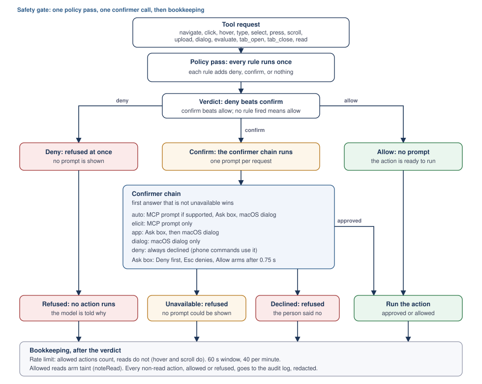
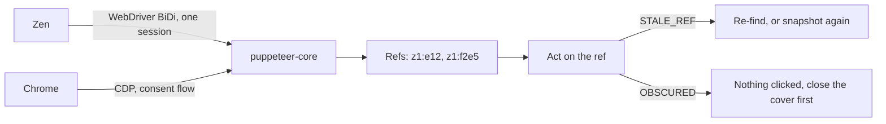
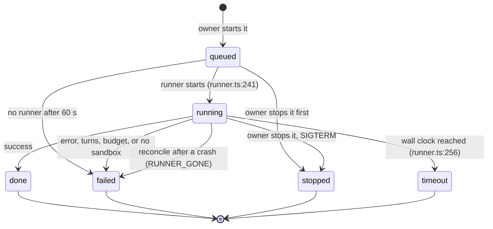
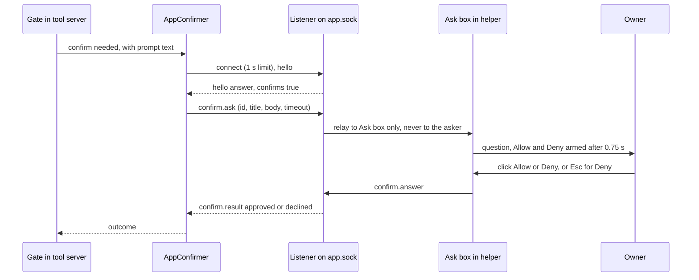
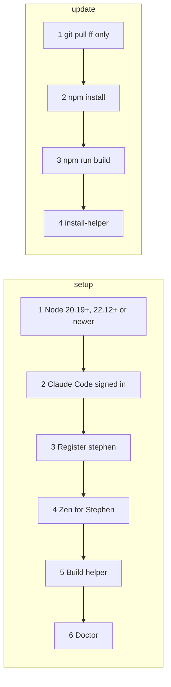

# 4. Deep dives

Describes `qa` at commit `5fae967` (2026-11-25).

Step four of the interview answer: open the boxes from [SYSTEM-DESIGN.md](SYSTEM-DESIGN.md). Each section says what
the part does, shows a diagram, lists the steps with their constants and code paths, then the failure modes. Terms:
see [README.md](README.md#words-used-on-these-pages).

## 4.1 Voice path

Stephen hears you on the Mac. A wake word or the F5 key starts a capture, voice detection ends it, and a local speech
model turns it into text. Routers answer memory, timer and job commands with no model. Everything else goes to a warm
Claude process, and the reply is spoken.

1. **Microphone.** 16 kHz mono through PvRecorder, 512-sample frames of 32 ms. `src/voice/audio.ts:6`, `src/voice/wav.ts:3`.
2. **Wake word, always on.** A sherpa-onnx keyword spotter (`src/voice/engine.ts:146-159`). Default phrases: "hey
   stephen", "yo stephen", "ok stephen", "stephen" (`src/voice/config.ts:42`). Threshold `keywordsThreshold` 0.3, and
   `bareWakeThreshold` 0.35 for the one-word phrase (`config.ts:102, 104`). With `verifyWake` on, the transcript must
   also contain the phrase (`src/voice/listener.ts:826-830`).
3. **Push to talk.** F5, or Fn+Option, read by the helper. A press under 250 ms is dropped, and a hold stops at 30 s
   (`src/helper/protocol.ts:68-70`). Key up ends the capture. The endpoint rules do not apply (`listener.ts:632-690`).
4. **Voice detection and end of command.** Silero VAD (`engine.ts:258-281`). Silence of 0.8 s ends the command
   (`silenceSec`, `config.ts:168`). After 2.5 s of speech the wait grows to 1.5 s (`longSilenceSec`, `config.ts:173`;
   `listener.ts:137`). Speech under 0.3 s does not count (`listener.ts:127`). A command is capped at 25 s
   (`maxCommandSec`, `config.ts:180`). No speech in 5 s ends the try (`config.ts:187`).
5. **Speech to text.** Default `whisper-small.en`. If it is not installed, `whisper-tiny.en` is used
   (`config.ts:18-20`, `src/voice/models.ts:135-147`). The wake phrase is then stripped (`src/voice/transcript.ts:153-166`).
6. **Routers, in this order:** memory, timer, job (`src/voice/assistant.ts:297-311`). A route with no leftover text
   is the whole answer. No model runs.
7. **Daily limit.** Checked before a model run only. The default is USD 1 (`src/voice/config.ts:195-199`). At 80% Stephen
   warns once a day. At 100% no new model run starts until midnight (`src/voice/daily-limit.ts:73-86`).
8. **Warm Claude.** Started on the wake word, or on key down (`src/voice/conversation.ts:396-410`). One process
   serves up to 25 commands (`MAX_WARM_COMMANDS`, `conversation.ts:316`) and at most 1800 s (`conversation.ts:318`).
   An unused one is dropped after 60 s (`conversation.ts:314`). If the warm probe fails, one `claude -p` runs per
   command (`src/voice/index.ts:465-469`).
9. **Speech out.** ElevenLabs, then Kokoro, then the macOS `say` command (`src/voice/tts/index.ts:29`).
10. **Stop and barge-in.** "stephen stop", Esc, or a new push to talk cancels the run or the speech. A wake word
    during a run cancels it. A wake word during Stephen's own speech is ignored (`listener.ts:402-409`).

The trust tier (`trusted`, `wake` or `phone`) is set by the source of the command. It decides what a voice command
may read or change (`src/voice/assistant.ts:18, 33-35`).

**Classifier note.** Tier 1 and Tier 2 is a label in shadow mode (`src/voice/grammar/classify.ts:2`). It tags the
latency row and decides which media commands run over sound. It does not route. Step 6 is the only router.

**Latency.** Stages are `speechEnd`, `captureEnd`, `asrDone`, `commandStart`, `replyReady`, `firstAudio`, `done`, `chime`
(`src/telemetry/latency.ts:46`). Targets: local routes p50 1.5 s and p95 2.5 s. Model runs p50 4 s and p95 8 s
(`src/telemetry/cli.ts:73`). The records stay on the Mac.

Failure modes:
- Wake word missed. The score is under the threshold, or the transcript check fails. Say it again, or use F5.
- Helper not running. There is no sound check, so a fixed 20 s cooldown after each command takes its place
  (`config.ts:149`, `listener.ts:441-449`).
- Warm probe fails. Each command starts a new process, which is slower.
- Daily limit reached. The reply says so, and nothing goes to Claude. Routers still answer.

**Why:** speech models run on the Mac, so only the command text reaches Claude. See [TRADE-OFFS.md](TRADE-OFFS.md).

## 4.2 Safety gate

Every tool call in `stephen serve` goes through one function, `SafetyGate.check` (`src/safety/gate.ts:307`). It runs
every policy rule in one pass, takes the strictest verdict, asks the owner only when a rule says confirm, and then
does its bookkeeping. Deny always beats confirm, and a deny never shows a prompt.

Rules in `src/safety/policy.ts` (`evaluate`, line 325):
- **Deny:** blocked-url, missing-element, secret-field, focus-unknown, control-in-text, rate-limit, `evaluate-disabled`
  (`allowEvaluate` is off), and `evaluate-too-long` (over 2000 characters, `policy.ts:429`).
- **Confirm:** `evaluate` (otherwise), sensitive-domain, high-risk-click, high-risk-key, destructive-shortcut, paste,
  upload, dialog-accept, cross-site-typing, first-interaction, first-destination, cross-site-navigate.

Confirmer chain (`src/safety/confirm.ts:457-480`). The first answer that is not `unavailable` wins. A decline in the
Ask box stops the chain, so it never falls through to the dialog.
- `auto` (default): MCP elicit if the client supports it, then the Ask box, then the macOS dialog.
- `app`: Ask box, then dialog. `elicit`, `dialog` and `deny` use one step each. `deny` never asks and always declines
  (`src/safety/confirm.ts:417-419`). Phone commands that reach Claude run `serve --confirm deny`
  (`src/voice/claude.ts:378`), so no confirmation is shown for them.
- Outcomes: `approved` runs the action. `declined` and `unavailable` refuse it, and the model gets a plain reply.
  The timeout is `confirmTimeoutSec`, 120 s by default (`src/config.ts:325`).

Allow and Deny (`helper/AskBox.swift:81, 97-105`, `helper/AppConfirm.swift:23-29`):
- Both buttons stay disabled for 0.75 s after each new question.
- Deny is first in focus order. Esc denies the first waiting question. Return is not bound to Allow.
- The macOS dialog defaults to Deny, and giving up is a decline (`confirm.ts:360-386`).

Bookkeeping, after the verdict:
- Rate limit: a 60 s window with 40 actions by default (`src/safety/policy.ts:88`, `src/config.ts:323`). Only allowed
  actions count, and reads do not. Hover and scroll do (`src/safety/gate.ts:362`, `src/safety/classify.ts:314-315`).
- Taint: a read arms `noteRead`, and private account reads arm `notePrivateData`. A later cross-site typing then
  needs a confirm (`policy.ts:516-538`).
- Audit log: one JSONL line per non-read action, allowed or refused, mode 0600, rotated at 5 MB with 3 files kept
  (`src/safety/audit.ts:11-12`). Secret-named keys are dropped. Typed text is kept as a length only. URLs keep the
  origin and path (`audit.ts:15-54`).

Untrusted text (`src/safety/index.ts:43-60`). Page text, find results, tab titles and app names are wrapped in
`<untrusted_web_content source="..." origin="...">`. Any `<` that starts this tag name, opening or closing, is written
as `&lt;`, so page text cannot close the wrapper early. The wrapper is used in `src/server/tools.ts`, `src/server/hub.ts`,
`src/server/util.ts` (`wrapPageText`) and `src/desktop/`.

Known gaps, which task W1 is fixing now: lookalike letters, full-width `＜`, and zero-width characters inside the tag
name are not caught. See [INJECTION-COVERAGE.md](../INJECTION-COVERAGE.md).

Failure modes:
- Confirm times out. The verdict is `declined`, and the action does not run.
- Ask box not running. The verdict is `unavailable`, and the next step in the chain is tried.
- Audit write fails. The append runs inside `check()`, before the caller acts. A failed write does not block the
  action. The error is reported through `onAuditError` (`src/safety/gate.ts:376-386`).

**Why:** one gate and deny-first keep every risky action behind one place to audit. The cost is extra prompts. See
[TRADE-OFFS.md](TRADE-OFFS.md).

## 4.3 Browser drivers

Stephen does not ship a browser. It attaches to the browsers the person already uses. Zen is driven over WebDriver
BiDi through `puppeteer-core`. Chrome is driven over the Chrome DevTools Protocol (CDP). Both give the tool server one
ref model, so a click names an element the same way in each.

- **Zen (`src/drivers/zen.ts`).** `zen.launch` defaults to `never` in real mode, so Zen is attach-only there. It
  defaults to `auto` in agent mode (`src/config.ts:14-15, 356`; `zen.ts:128-131`). Stephen waits for Zen's log to print
  a "WebDriver BiDi listening on ws://" line, then connects to it. The line is matched by `parseBidiListening`
  (`src/drivers/macos.ts:140`), and the poll is in `zen.ts:626`. The launcher is named "Zen for Stephen"
  (`zen.ts:101`). Gecko takes one BiDi session at a time, so `disconnect()` must end it (`zen.ts:16-17`). Agent mode
  uses a separate profile.
- **Chrome (`src/drivers/chrome.ts`).** Real mode reads `DevToolsActivePort` in the profile, and Chrome 144 and later
  asks the person to allow the connection. Each new connection asks again, so one connection is kept open
  (`chrome.ts:6-7, 123, 141`). Agent mode starts a Stephen profile on 127.0.0.1 (`chrome.ts:69-79`). Disconnecting
  never closes Chrome.
- **Refs (`src/refs.ts:4-17`).** `z1:e12` is element 12 in the main frame of tab z1. `z1:f2e5` is element 5 in child
  frame 2. Numbers keep counting across navigations, so an old ref names nothing new (`src/page/frames.ts:102-103`).
- **Errors.** `STALE_REF` means the element is gone, so take a new snapshot. On a click the hub re-finds once, and only
  when exactly one live element has the same role, name, tag and href. The gate must then allow that click without
  asking (`src/server/hub.ts:358-367`; rule at 351-357; the in-page count is `src/page/runtime.ts:966-987`). `OBSCURED` means another element covers the target, so nothing is
  clicked (`src/page/index.ts:552-575`).
- **Not built.** [ADR-009](../ADR-009-zen-webextension.md) proposes a WebExtension path to the normal Zen. It is
  paper only. No add-on code ships.

Failure modes: Zen is closed or was not started with Stephen access, so the drivers return `NEEDS_USER` and the
person is asked to open "Zen for Stephen". A stale DevTools port is reported as stale.

**Why:** the person's own signed-in browser is used, so no second set of logins is needed. See
[TRADE-OFFS.md](TRADE-OFFS.md).

## 4.4 Jobs and the sandbox

A job is a longer task. Claude Code runs it in the background in one job folder. It starts only after a click in the
dialog. The job runs in Claude Code's own sandbox, with no Stephen tools, no browser and no network for its shell.

- **Caps (`src/jobs/config.ts`).** At most 2 jobs run at once (`maxRunning`). At most 10 starts a day (`dailyStarts`).
  Wall clock is 45 min by default, with a hard cap of 180. Turns default to 150, up to 500 (`maxTurns`, `src/jobs/config.ts:27`). Each job has a USD 5 budget
  (`maxBudgetUsd`, up to 50).
- **Tools (`src/jobs/spec.ts:16-28`).** Bash, Read, Edit, Write, Glob and Grep. Web tools only when the task says
  "with web". WebFetch, WebSearch, Agent and NotebookEdit are off. Bash cannot run `git push`, `open` or `osascript`.
- **Sandbox (`spec.ts:206-223`).** Claude Code's own sandbox, set to fail if it is missing. Unsandboxed commands are
  off. No network domains and no Unix sockets are allowed, so a job cannot reach `app.sock` or `helper.sock`. `denyRead` (the
  Stephen home, `~/.ssh`, `~/.aws`, `~/.config` and Keychains) covers shell commands through the OS sandbox
  (`spec.ts:202-203, 218`). The file tools (Read, Glob, Grep, Edit, Write) are limited to the working directory by
  `blockReadsOutsideWorkingDirectories` (`spec.ts:221-222`).
- **Environment (`spec.ts:229`).** Only PATH, HOME, LANG, TMPDIR, USER and two flags reach the job.
- **Reconcile (`src/jobs/state.ts:179-214`).** On every list, a job whose runner is gone, or whose deadline plus
  15 min has passed, becomes `failed` with RUNNER_GONE. Any Claude process left from that job is killed. Finished jobs older
  than `keepDays` (default 30, 1 to 365, `src/jobs/config.ts:34`) lose their state file and meta folder (logs and
  settings). The job folders stay (`purgeJobs`, `src/jobs/state.ts:273-278`).

Failure modes: no sandbox means "nothing ran" (`src/jobs/runner.ts:51-60`). Running out of turns or budget is
`failed`. A crash is cleaned up on the next list.

**Why:** a job cannot reach the network or Stephen's own state, so a bad model run has less to damage. See
[TRADE-OFFS.md](TRADE-OFFS.md).

## 4.5 Helper app and sockets

The helper is a small Swift menu bar app, bundle `dev.stephen.helper`. It owns the keys (F5, Fn+Option and Esc), the
Ask box and the window. It never records audio. The listener and the helper talk over two Unix sockets in
`<home>/run/`. The tool server reaches the owner only through `confirm.ask` on `app.sock`.

| Socket | Path | Served by | Used by |
|---|---|---|---|
| `app.sock` | `<home>/run/app.sock` (`src/app/server.ts:58-60`) | listener | Ask box, window, the gate's confirm client |
| `helper.sock` | `<home>/run/helper.sock` (`src/helper/paths.ts:19-21`) | helper (`helper/Core.swift`) | listener (`src/helper/client.ts`) |

- **Permissions.** The `run` folder is 0700 and the socket is 0600, both owned by you. There is no token, so the file
  mode and the same-user rule are the access control (`src/lib/private-socket.ts:41-85`). A live socket is never
  replaced. The path must fit in 103 bytes.
- **Limits.** 8 clients at once (`src/app/server.ts:63`). 256 KiB per line (`src/app/protocol.ts:100`). 2000
  characters of chat text (`protocol.ts:102`). 8 MiB of queued output per client, then the client is dropped
  (`server.ts:65`). Helper messages are small, at most 4 KiB each (`src/helper/protocol.ts`).
- **Owner only.** `chat.resume`, `chat.edit`, `jobs.edit` and version delete are refused from any connection that is
  not the Stephen window (`isWindow`, `src/app/server.ts:425-427`, checked at 437, 481, 497 and 518). A confirm answer
  counts only from an Ask box that is not the asker (`server.ts:344-349`).

Failure modes: the helper is not running, so there are no F5 or Esc keys, and the listener uses the cooldown. A
connect or hello that fails in 1 s is `unavailable`, so the next step in the chain is tried.

**Why:** the keys and the Allow buttons live in an app with no audio. The tool server can ask a question through
it and get only the answer back. See [TRADE-OFFS.md](TRADE-OFFS.md).

## 4.6 Setup and update

`stephen setup` runs six steps and stops at the first red one. It is safe to run twice. `stephen update` runs four
steps, and it stops before any change if the tree is dirty or HEAD is detached. The helper is built on the Mac with
ad hoc signing today. [ADR-011](../ADR-011-packaging-signed-app.md) (proposed) would ship one signed app, and
[ADR-012](../ADR-012-updates-sparkle.md) (proposed) would add in-app updates.

- **Setup (`src/setup.ts:56-125`).** 1, checks Node: 20.19 or newer on 20, 22.12 or newer on 22, or any newer major (`nodeSupported`,
  `src/cli.ts:290-293`). The message at `src/setup.ts:70` still says "Node 22 or 24". 2, checks `claude --version` and `claude auth status`. 3, registers
  the `stephen` MCP server with `stephen install --run`. 4, creates "Zen for Stephen" if it is missing. 5, builds
  Stephen Helper. 6, runs `stephen doctor --json`. macOS permissions are then named in the output.
- **Update (`src/update.ts:53-110`).** Stops if the folder is not a git checkout, HEAD is detached, or
  `git status --porcelain --untracked-files=no` shows changes to tracked files (`src/update.ts:72`). Untracked files do
  not block it. Then `git pull --ff-only`, `npm install`, `npm run build` and
  `install-helper`. If the helper changed, macOS may ask for Input Monitoring again.
- **Helper fingerprint (`src/helper/install.ts:207, 353-357`).** A sha256 over the Swift sources, the Info.plist
  template, the version, and the compiler and its flags. If it matches the stamp and `codesign --verify` passes,
  nothing is rebuilt. The app keeps its macOS permissions.
- **Doctor (`src/helper/doctor.ts:32-104`, `src/cli.ts:191`).** Checks the helper is installed, Xcode command line tools
  and `swiftc`, a usable macOS SDK, the helper is running, the socket answers the protocol version, Input Monitoring
  is granted, and Accessibility for media keys (information only). A failed blocking check exits with 1.

Failure modes: no Xcode command line tools stops the helper build, with the fix in the message. Local edits stop the
update before anything changes.

**Why:** the Mac builds its own helper, so there is no hosted server to install or keep. See
[TRADE-OFFS.md](TRADE-OFFS.md).

Next: [TRADE-OFFS.md](TRADE-OFFS.md).
