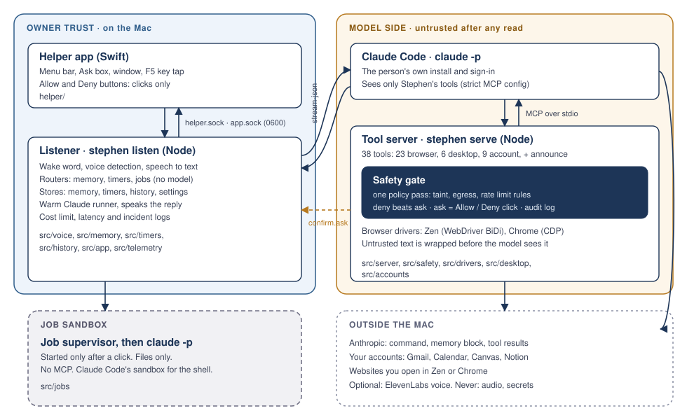
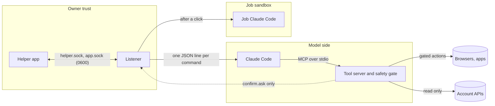
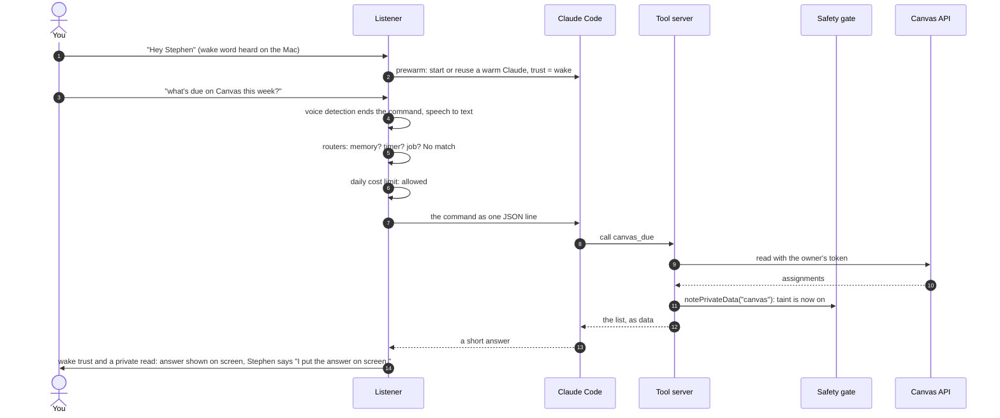

# 2. High-level design

Step two of the interview answer: draw the boxes, name the boundaries, then walk one request through them.
Describes `qa` at commit `5fae967` (2026-11-25). Terms: see [README.md](README.md#words-used-on-these-pages) and the
glossary, `docs/guide/GLOSSARY.md`.

## 2.1 The parts

Five kinds of process run on the Mac. Only one of them, the tool server, is reachable by the model.

| Process | What it is | Holds | Code |
|---|---|---|---|
| **Helper app** | A small Swift menu bar app. | The F5 and Fn+Option keys and Esc (these need the Input Monitoring permission), the Ask box, the window, the Allow and Deny buttons. It never records audio. | `helper/` |
| **Listener** (`stephen listen`) | The Node process that hears you. | Wake word, speech to text, the local routers, memory, timers, history, settings, the cost limit, the logs. | `src/voice/`, `src/app/` |
| **Claude Code** (`claude -p`) | The person's own Claude Code, started by the listener. | The model session and the person's Claude sign-in. Its built-in tools are turned off. | started in `src/voice/claude.ts` |
| **Tool server** (`stephen serve`) | Started by Claude Code from a strict MCP config. | The 38 tools (plus `announce` on the voice path), the safety gate, the browser drivers, the audit log. | `src/server/`, `src/safety/` |
| **Job runner** (`stephen jobs _run`, then `claude -p`) | A background task, started only after a click. | One job folder. No MCP, no network for the shell. | `src/jobs/` |

The browsers (Zen and Chrome) are the person's own. Stephen attaches to them; see
[DEEP-DIVES.md](DEEP-DIVES.md).

## 2.2 Trust boundaries

A trust boundary is a line where the code on one side must not believe the other side. Stephen has three.

1. **Owner and model.** The model can call only the tool server. The tool server cannot load the memory, history,
   app or job code: a test scans its imports (`test/memory/boundary.test.ts`, using `test/helpers/import-scan.ts`).
   So the model has no way to write memory, timers or jobs, and no tool name even looks like one.
2. **Model and the world.** Every browser and desktop action and every private read in the tool server passes the
   safety gate first.
   Everything the model reads from a page is wrapped as untrusted text. The one link back to the owner side is
   `confirm.ask`: the gate may ask the listener to show a question in the Ask box, and gets back only the answer.
3. **Jobs and everything else.** A job runs in Claude Code's own sandbox, with no MCP, no network for its shell,
   and no read access to Stephen's home, `~/.ssh`, `~/.aws`, `~/.config`, the Keychain folder or the Stephen
   repo's `.env` file (`src/jobs/spec.ts`).

Access to the two sockets is by file permission: a 0700 folder and 0600 sockets, so only the same macOS user can
connect (`src/lib/private-socket.ts`). There is no token. [TRADE-OFFS.md](TRADE-OFFS.md) says why that is enough.

## 2.3 One request, end to end

"Hey Stephen, what's due on Canvas this week?"

What each step shows:

- **Steps 1 and 2.** Claude Code starts while you are still talking, so its start-up time hides behind your
  speech. This is the warm runner (`src/voice/conversation.ts`).
- **Steps 3 to 5.** Speech to text and the routers run on the Mac. A memory, timer or job command would stop here,
  free and without the model (`src/voice/assistant.ts`).
- **Step 6.** The cost limit is checked only before a model run, so the routers and "stop" are always free
  (`src/voice/daily-limit.ts`).
- **Step 11.** Reading private data arms the taint before the data goes back to the model. From now on, any action that could
  carry that data out (typing on another site, opening a web address with data in it) needs an Allow click.
- **Step 13.** A command started by the wake word is less trusted than one started by a key, because anyone in the
  room can say the wake word. So a private answer goes on the screen, not out loud. See the trust tiers in
  [TRADE-OFFS.md](TRADE-OFFS.md).

## 2.4 Interfaces

There is no public API. The interfaces are local.

| Interface | Between | Shape | Code |
|---|---|---|---|
| MCP tools | Claude Code and the tool server | 38 tools over stdio, plus `announce` on the voice path (and `evaluate` if the owner turns it on). Most acting tools require an `intent` sentence; `browser_connect` and `hover` make it optional. | `src/server/tools.ts`, `src/desktop/index.ts`, `src/accounts/index.ts` |
| `app.sock` | The listener (server) and the helper window, the Ask box, the gate (clients) | One JSON message per line, at most 256 KiB. About 40 request types: chat, history, memory, settings, jobs, confirm. | `src/app/protocol.ts` |
| `helper.sock` | The helper (server) and the listener (client) | One JSON message per line, at most 4 KiB. Key events in, state and media keys out. | `src/helper/protocol.ts` |
| Claude Code stream | The listener and `claude -p` | stream-json on stdin and stdout, one user line per command. | `src/voice/warm-claude.ts` |
| CLI | The person and Stephen | `stephen setup`, `doctor`, `listen`, `update`, `report`, `latency`, `history`, `memory`, `jobs`. | `src/cli.ts` |

## 2.5 Design principles

1. **The model never writes the owner's state.** Memory, timers and jobs are written only from the owner's own
   words, by local rules in the listener.
2. **Text read is data, never instructions.** Pages, emails and tab titles arrive wrapped and marked.
3. **Allow and Deny are clicks.** Nothing spoken or typed by the model can approve an action. Deny is the default
   button and Esc means Deny.
4. **Fail closed on safety, fail open on comfort.** An unknown element or focus is denied. A cost limit that cannot
   read its numbers lets the command run.
5. **Local first, measured always.** Every command leaves a latency record with times and code words, never words.

Next: [DATA-MODEL.md](DATA-MODEL.md).
