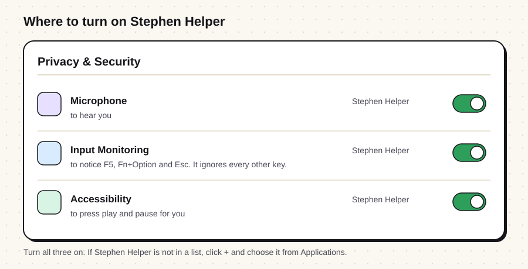
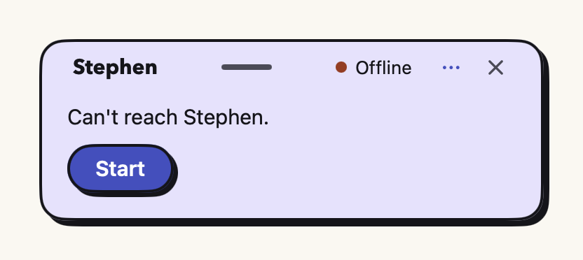
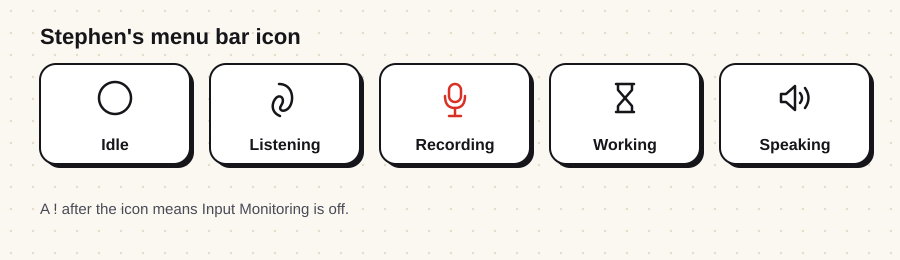

# Getting started

This page walks you through setting up Stephen, step by step. It takes about 30 minutes the first time. If a step
goes wrong, Stephen tells you what to do, and you can run setup again safely.

New words? The [glossary](GLOSSARY.md) explains each one.

## Step 1. Check your Mac

You need:

- [ ] **A Mac with Apple silicon** (M1 or newer). Apple menu > About This Mac. It should say "Chip: Apple M..."
- [ ] **macOS 14 (Sonoma) or newer.** The same window shows the macOS version.
- [ ] **A Claude plan with Claude Code**, signed in with your own account. Stephen uses your plan.
- [ ] **Zen or Google Chrome.** One is enough.

## Step 2. Install the tools Stephen needs

Open the **Terminal** app (press Cmd+Space, type "Terminal", press Return). You will paste a few commands here.

1. **Node** (version 22 or 24). Download it from [nodejs.org](https://nodejs.org), or run `brew install node` if you
   use Homebrew. Check it with:

   ```bash
   node --version
   ```

2. **Claude Code**, signed in. Check it with:

   ```bash
   claude --version
   ```

3. **Apple's command line tools.** If they are missing, setup tells you the one command to run.

## Step 3. Download and set up Stephen

Paste this into Terminal and press Return. It downloads Stephen and builds it:

```bash
git clone https://github.com/CrisH2307/stephen.git && cd stephen && npm install && npm run build && npm link
```

Then run setup:

```bash
stephen setup
```

Setup does six things, and stops at the first problem with a clear fix:

1. Checks Node and Claude Code.
2. Connects Stephen to Claude Code.
3. Creates the "Zen for Stephen" app (for Zen users, see step 5).
4. Builds the Stephen Helper app.
5. Runs a health check (`stephen doctor`).
6. Lists the three Mac permissions to turn on.

Setup never asks for a password or a key.

## Step 4. Turn on three Mac permissions

<p align="center">
  
  <br><sub>Illustration with made-up sample text, not a real screenshot.</sub>
</p>

Open **System Settings > Privacy & Security**, then turn on **Stephen Helper** in each of these:

| Permission | Why Stephen needs it |
|---|---|
| **Microphone** | To hear you. |
| **Input Monitoring** | To notice when you hold F5 or press Esc. It ignores every other key. |
| **Accessibility** | To press play and pause for you. |

If "Stephen Helper" is not in a list, click **+** and choose it from your Applications folder (Home > Applications).

## Step 5. Get your browser ready

Do this for the browser you use. You can do both.

**Zen.** Drag **Zen for Stephen** (in the Applications folder inside your home folder) to your Dock. From now on, open Zen with this icon
instead of Zen's own icon. It is your normal Zen, with your tabs and sign-ins, opened in a way Stephen can use.
When you don't need Stephen in Zen, quit Zen (Cmd+Q) and open it normally.

**Chrome.** Once only:

1. In Chrome, open `chrome://inspect/#remote-debugging`.
2. Turn on **Allow remote debugging for this browser instance**.
3. The first time Stephen connects, Chrome asks. Click **Allow**.

## Step 6. Your first command

First make sure Stephen is running: click the Stephen icon in the menu bar. If the Ask box says "Can't reach
Stephen", click **Start**.

<p align="center">
  
  <br><sub>Real screenshot of the Ask box in the Paper look. Click Start.</sub>
</p>

Then hold **F5**, say **"what time is it"**, and let go. Stephen answers out loud.

<p align="center">
  
  <br><sub>Illustration with made-up sample text, not a real screenshot.</sub>
</p>

Watch the Stephen icon in the menu bar. It changes shape as Stephen works: idle, listening, recording, working,
speaking.

**F5 does nothing, or starts Dictation?** Some Mac keyboards use F5 for Dictation. Hold **Fn+F5**, or hold
**Fn+Option** instead. Both work.

## Step 7. Keep it up to date

Run this now and then:

```bash
stephen update
```

It tells you if you need to turn on Input Monitoring again (only when the helper app was rebuilt). It also prints
the previous version's id, so you can go back.

## If something goes wrong

1. Run `stephen doctor`. It checks everything and prints a fix next to each red line.
2. Look in the troubleshooting table of the [full technical setup](ADVANCED-SETUP.md#troubleshooting).
3. Still stuck? Ask Cris, or open an issue on GitHub. Issues are public: never paste private text or screenshots of
   your accounts.

## Removing Stephen

The [privacy page](../PRIVACY.md#9-deleting-everything) lists every step to delete Stephen and everything it
kept.

Next: [using Stephen every day](USING-STEPHEN.md).
