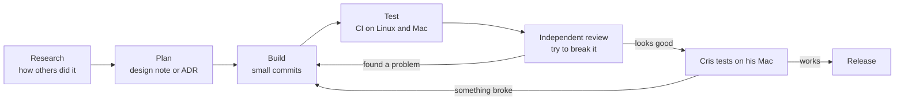
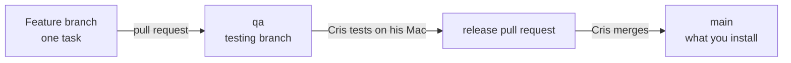

# How we built Stephen

Stephen was built by Cris with a team of AI [agents](GLOSSARY.md#agent). Cris decides what to build and tests it
on his Mac. The agents research, plan, write code, test and review each other. This page explains how that works,
and why it keeps Stephen safe.

## The short version

1. **Research first.** Before building something new, we read how others solved it and wrote down what we found.
2. **Write the plan down.** Big decisions get a short design note or an [ADR](GLOSSARY.md#adr-architecture-decision-record).
3. **Small changes.** One task, one branch, one [pull request](GLOSSARY.md#pull-request-pr), many small commits.
4. **Test everything.** Robots run all the tests on Linux and on a Mac for every change ([CI](GLOSSARY.md#ci-continuous-integration)).
5. **Someone else checks.** An [independent review](GLOSSARY.md#independent-review) tries to break each piece.
6. **Cris tries it for real.** He runs a written test plan on his own Mac before anything reaches the main version.

## The safety-first loop

Every change goes around this loop. A safety change goes around it with extra care.

When a reviewer finds a problem, it gets a short name (like `R9-3`, the third finding of review 9), a fix, and a
test with the same name. That test stays forever, so the same mistake cannot come back unnoticed.

## The agent team

Many agents work at the same time, each in its own [worktree](GLOSSARY.md#worktree) (its own copy of the code), so
they don't get in each other's way. They are grouped into lanes, like teams in a company:

| Lane | Job |
|---|---|
| **Top lead** | Keeps the list of work moving, answers the other agents' questions, and asks Cris only what truly needs him. |
| **Dev lane** | Writes and fixes the code. |
| **Review lane** | Reviews pull requests and prepares each release for Cris. |
| **UI lane** | Designs the app windows, themes and pictures. |
| **OpenCode lane** | Helpers running on free models for easy work: first drafts, simple tests, format changes. |

Lanes talk to each other through GitHub issues, in plain sentences, so Cris can read every message.

### The right model for each job

Not every task needs the strongest AI. We match the [model](GLOSSARY.md#ai-model) to the task:

| Task | Model |
|---|---|
| Research and planning | Claude Fable |
| Writing code, safety code, hard bugs, final reviews | Claude Opus |
| Normal coding | Claude Sonnet |
| Quick read-only checks (like fact checking this page) | Claude Haiku |
| First drafts, summaries, format changes | Free models |

The stronger model always checks the cheaper model's work. For example, a free model wrote the first draft of the
[glossary](GLOSSARY.md). It had wrong facts, so it was rewritten by hand from the code, and then a separate agent
checked every claim against the code again.

## How we keep safety first

- **Rules in code, not in the AI.** The [safety gate](GLOSSARY.md#safety-gate) is normal code. The AI cannot talk
  its way past it.
- **Extra review for safety changes.** Any change to the safety code, the Allow / Deny cards, or the code that
  writes memory, timers and jobs is marked `[DEV REVIEW]` and needs a second, independent review.
- **Attack tests with the real AI.** `stephen eval` runs the real Claude against fake pages, emails and Canvas posts
  that hide orders. The test passes only if Claude ignores the orders. In one test, Claude even told the user about
  the planted instruction instead of following it.
- **Eleven rounds of independent review so far** (`docs/REVIEW-1.md` to `docs/REVIEW-10B.md`). Each finding was
  fixed with a test named after it.
- **Numbers, not feelings.** Speed, reliability and privacy goals are written down with today's measured values
  and the gap to close ([NFR](GLOSSARY.md#nfr-non-functional-requirement), in `docs/NFR-STEPHEN.md`).
- **The privacy list matches the code.** The table of everything that leaves your Mac was checked line by line
  against the code ([privacy](../PRIVACY.md), [data stores](../DATA-STORES.md)).

## How a change reaches you

- Every change first goes to `qa`, the testing branch. Nothing goes straight to `main`.
- Cris builds `qa` on his Mac and works through the Mac test plan (`docs/MAC-TEST-PLAN.md`).
- When it passes, one release pull request moves the whole batch to `main`. Only Cris merges it.
- `stephen update` on your Mac pulls the new `main`.

## Where to read more

| If you want | Read |
|---|---|
| The big picture design and the algorithms | `docs/SYSTEM-DESIGN-STEPHEN.md` |
| The research we did | `docs/RESEARCH.md`, `docs/RESEARCH-STEPHEN.md`, `docs/research/` |
| Why each big decision was made | `docs/ADR-001-browser-control-stack.md` and the other ADR files |
| The rules every agent follows | [AGENTS.md](../../AGENTS.md) |
| How branches and releases work | `docs/BRANCHING.md` |

Next: [get started](GETTING-STARTED.md).
