# What is Stephen?

Stephen is a helper you talk to on your Mac. You say what you want in normal words, and it does it in your
browser or on your Mac. Before anything risky, it stops and asks you.

  

## In one minute

- **You talk.** Say "Hey Stephen", or hold the **F5** key, and say what you want. You can also type in the
  [Ask box](GLOSSARY.md#ask-box).
- **Your Mac writes it down.** [Speech to text](GLOSSARY.md#speech-to-text) runs on your Mac. Your voice never
  leaves it.
- **Claude plans the steps.** The text goes to [Claude](GLOSSARY.md#claude), the AI behind Stephen, on your own
  [Claude plan](GLOSSARY.md#claude-plan).
- **Stephen checks every step.** Its [safety gate](GLOSSARY.md#safety-gate) does safe steps, asks you before
  risky ones, and refuses dangerous ones.
- **It answers.** Stephen says the result out loud in a short sentence, or shows it if you typed.

## What it can do

| You say | Stephen |
|---|---|
| "Open YouTube" | Opens it in your browser (Zen or Chrome) |
| "Play some lofi" | Finds it on YouTube and plays it |
| "Pause", "next", "volume down" | Controls what is playing |
| "Set a timer for 10 minutes" | Sets a timer and tells you when it is done |
| "Remember that my locker is number 12" | Keeps it in its [memory](GLOSSARY.md#memory) on your Mac |
| "What's the weather?" | Gives today's weather for your place |
| "What's due on Canvas this week?" | Reads your Canvas (once you connect it) |
| "What's my day?" | The weather, today's calendar and what is due on Canvas, in 3 or 4 sentences (once connected) |
| "Read this page and summarize it" | Reads the page in your browser and tells you the main points |
| "While I'm cooking, write a first draft of my lab report" | Starts a background [job](GLOSSARY.md#job) after you click Start |

Stephen only **reads** your email, calendar, Canvas and Notion. It cannot send an email or post for you on those
accounts.

## What it will not do

- **Type your passwords, one-time codes or card numbers.** You type those yourself.
- **Act on a risky step without your click.** Sending, buying, paying, deleting, posting and uploading all wait
  for **Allow**. A spoken "yes" never counts.
- **Obey a web page.** If a page or email has hidden orders for the AI, Stephen treats them as plain text.
- **Solve CAPTCHAs** (the "are you a robot?" puzzles). You do those.
- **Open the Terminal, System Settings or your password manager.** Those are always refused.

## The parts, in plain words

| Part | What it is |
|---|---|
| **Stephen Helper** | A small app in your [menu bar](GLOSSARY.md#menu-bar). It hears F5, shows the Ask box and the Allow / Deny cards. |
| **The listener** | The part that hears "Hey Stephen" and turns your voice into text, on your Mac. |
| **Claude Code** | Anthropic's program that runs Claude. Stephen starts it in the background, with your own Claude account. |
| **Stephen's tools** | The only things Claude can do: open a tab, click, read a page, set a timer, and so on. Each one goes through the safety gate. |
| **Your browser** | Your own Zen or Chrome, signed in as you. Stephen works in the tabs you already use. |

## Who it is for

Right now Stephen is in a **friends beta**: Cris and a few friends with Apple silicon Macs, who already use
Claude. Setting it up needs the Terminal a few times. Later, the plan is to make it easy for anyone on a Mac.

## Honest limits today

- **"Hey Stephen" is slower than F5.** On Cris's Mac, F5 replies came in about 2 seconds (the median), and wake
  word replies took about 10 seconds. We are working on it.
- **Only Zen and Chrome** for now.
- **The AI can make mistakes.** Claude can misunderstand or be wrong. Read the Allow / Deny card before you click
  Allow, and check answers that matter.

Next: [why we built Stephen](MOTIVATION.md), or jump to [getting started](GETTING-STARTED.md).
