# The Stephen guide

Plain-word pages about Stephen: what it is, why it exists, how we built it and how to use it. Short sentences,
pictures, and every technical word explained in the [glossary](GLOSSARY.md).

  

## Read in this order

| | Page | What it covers |
|---|---|---|
| 1 | [What is Stephen?](INTRODUCTION.md) | What it does, what it won't do, and its parts |
| 2 | [Why we built it](MOTIVATION.md) | The problem with AI helpers, and our answer |
| 3 | [How we built it](HOW-WE-BUILT-IT.md) | The agent team, the reviews and the safety-first loop |
| 4 | [Getting started](GETTING-STARTED.md) | Set it up, step by step, with pictures |
| 5 | [Using Stephen every day](USING-STEPHEN.md) | The three ways to talk, things to try, the Stephen window |
| 6 | [Safety in plain words](SAFETY-IN-PLAIN-WORDS.md) | The Allow / Deny card, prompt injection, what leaves your Mac |
| 7 | [Questions people ask](FAQ.md) | Short answers to common questions |
| | [Glossary](GLOSSARY.md) | Every technical word, in plain English |

## For the details

| Page | What it covers |
|---|---|
| [Full technical setup](ADVANCED-SETUP.md) | Every command, setting and fix |
| [Privacy](../PRIVACY.md) | What Stephen keeps on your Mac and what leaves it |
| [Data stores](../DATA-STORES.md) | Every file Stephen keeps, for how long, and how to delete it |

Most pictures in this guide are drawings of the app (marked "Illustration"). The ones marked "Real screenshot" are
taken from the app itself. All of them use made-up sample text and never show anyone's private data.
