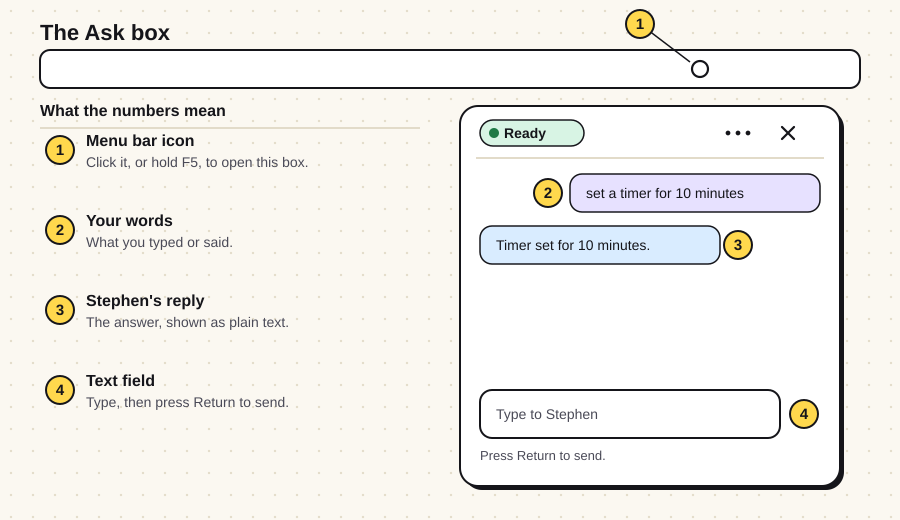

# Using Stephen every day

## Three ways to talk to Stephen

| Way | How | Best for |
|---|---|---|
| **Hold F5** | Hold F5, talk, let go. (Fn+Option works too.) | Most things. It is the fastest way and gets full trust. |
| **"Hey Stephen"** | Say "Hey Stephen" (or "Yo Stephen", "OK Stephen", or just "Stephen"), then your command. | When your hands are busy. |
| **Type** | Click the Stephen icon in the menu bar, type in the Ask box, press Return. | Quiet places, or long requests. Replies show as text. |

  

**Why does F5 get more trust than "Hey Stephen"?** Anyone in the room, or a video, can say "Hey Stephen". Only you
can hold your F5 key. So after the wake word, Stephen is more careful: for example it asks before it remembers
something, and it says how many things it remembers instead of reading them out loud.

**Music playing?** While your Mac plays sound, "Hey Stephen" only works for media commands like "pause", "next" or
"volume down". For anything else, Stephen says "Hold F5 for that." This stops a video from giving orders.

## Stop it

- Press **Esc**, or say **"Stephen, stop"**. Stephen stops what it is doing, or stops talking.
- Holding F5 while Stephen works also cancels it first, then records your new command.

## Things to try

**Browser**
- "Open YouTube" / "Open my Gmail in Chrome"
- "Read this page and tell me the main points"
- "Find the Export button on this page and click it" (Stephen asks first if the click is risky)

**Music and video**
- "Play Say So by Doja Cat"
- "Pause" / "Next" / "Volume down" / "Mute"

**Timers and reminders**
- "Set a timer for 10 minutes"
- "Remind me at 6 to call home"
- "Cancel the timer"

**Memory** (kept on your Mac, at most 30 items)
- "Remember that my gym is on King Street"
- "What do you remember?"
- "Forget my gym" / "Forget that" / "Forget everything" (this one always asks first)

**Your accounts** (only after you connect them; Stephen only reads)
- "What's due on Canvas this week?"
- "What's on my calendar today?"
- "What's my day?" (the weather, today's calendar and what is due)
- "What's the weather?" (works without connecting anything)

**Your Mac**
- "Open Spotify" (common apps open straight away; other apps ask you first)

**Background jobs**
- "While I'm cooking, write a first draft of my lab report"
- Stephen shows a card first. The job starts only when you click **Start**. You can watch it, and stop it, in
  the **Jobs** page of the Stephen window.

## Follow-ups

A command soon after the last one (within 3 minutes) continues the same conversation:

> "Hey Stephen, how long is the train to downtown?"
> "About 40 minutes."
> "Hey Stephen, what about by car?"

Stephen knows "what about by car" still means downtown. Press Esc or say "Stephen, stop" to start fresh.

## The Stephen window

Right-click the Stephen icon and choose **Open Stephen...**. The window has five pages in its sidebar:

| Page | What you find there |
|---|---|
| **Home** | A quick start: suggestions to try and your recent commands. |
| **Conversations** | Everything you said and Stephen's replies, typed and spoken, including what it refused. |
| **Jobs** | Background jobs: what they did, their folder, and **Stop**. |
| **Memory** | What Stephen remembers. Add, edit or forget items. |
| **Settings** | How Stephen talks, your connected accounts and browsers, privacy and permissions, and the look. |

## When Stephen asks you

When a step is risky, a card shows what Stephen wants to do. Read it, then click **Deny** or **Allow**. Learn to
read the card in [safety in plain words](SAFETY-IN-PLAIN-WORDS.md#the-allow--deny-card).

## Tips

- **Say which browser if it matters:** "in Chrome, open ...". Otherwise Stephen uses your default (Zen).
- **Use your open tabs:** open a page yourself and say "this tab" or "this page".
- **Short and clear works best:** one sentence, one or two things.
- **Passwords, codes and CAPTCHAs:** Stephen asks you to do those yourself. Do them, then tell Stephen to go on.

Next: [safety in plain words](SAFETY-IN-PLAIN-WORDS.md).
