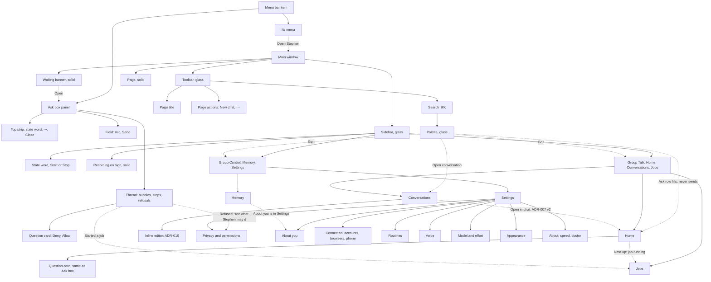

# Stephen app UI v4: structure, navigation, ⌘K and glass (plan)

Status: a plan from the review lane, 2026-11-18. Revised 2026-11-19 with the dev lane's four paper fixes (PR #236). **Nothing here is built.** The dev lane approves, changes or rejects
it before any build starts. Builds after the `AppClient.swift` split, in 5 steps, one PR each (section 9).

Builds on: `docs/research/UI-V4-DIRECTION.md` (tokens, stories S1 to S9), `docs/research/UI-REVIEW-2026-11.md`,
`docs/UI-PLAN.md` (v3.2) and `docs/UI-NEXT-PLAN.md` (owner answers of 2026-11-08). Where those agree with this plan,
they are linked, not repeated. Code facts below are from `qa` at `7474ed1`.

Mock: `docs/research/ui-v4-mock/index.html` (one file, no network). Pictures for discussion, not the app.
Glass check: `node docs/research/ui-v4-mock/glass-contrast.mjs`.

**Review marks.** `[DEV REVIEW]` marks every change that touches a surface the dev lane must review first: the
question card (Allow or Deny), the source label, steps and refusals, the Ask box send, cancel and Esc behaviour, and the
"Recording on" sign.

---

## 1. The plan in five lines

1. Fewer places: 5 sidebar rows in 2 groups. Personal goes away; its parts move to Memory and Settings. Nothing shows in
   two places.
2. One window header (the toolbar) holds the page title, the page's own buttons, and a search button with ⌘K.
3. ⌘K opens a palette: go to a page, find a past conversation, run a safe app action. It never approves and never
   sends anything to the model.
4. Each page puts what you do first at the top. Rare things sit in accordions, closed by default, remembered per page.
5. Light glass on the sidebar, the toolbar and the palette only. Everything that holds content or safety stays solid.

---

## 2. Inventory (today, on `qa`)

Every element, page by page, with its group. "Dup" points to the redundancy list (section 4).

### 2.1 Window shell (`MainWindow.swift`, `Components/Sidebar.swift`, `AppWindow.swift`)

| Group | Element | Notes |
|---|---|---|
| Sidebar top | Wordmark "Stephen" | |
| Sidebar top | Collapse button (⌘\\), 60 pt icon rail | |
| Sidebar | "Ask Stephen ⌘K" field (a button that opens the Ask box) | Dup R2 |
| Sidebar | Label "STEPHEN": Home ⌘1 (badge: waiting questions), Conversations ⌘2, Jobs ⌘3 | Dup R1 ("Stephen" twice) |
| Sidebar | Label "YOU": Personal ⌘4, Settings ⌘5 | Memory has no row (dead end D1) |
| Sidebar bottom | Status: dot and word (Listening, Microphone off, Starting, Stopped, Connecting, Offline), Start or Stop, or a Terminal icon | At the bottom (HIG says top) |
| Sidebar bottom | "Recording on" with a waveform | `[DEV REVIEW]` surface |
| Content top | Waiting-question banner: "Stephen is waiting for your OK", Open | On every page (#138) |
| Content | Offline view replaces every page; Settings keeps Appearance (#144) | |
| App menu | Ask Stephen ⌘K, Settings… ⌘,, Close Window ⌘W; Edit menu | ⌘K opens the Ask box today |

### 2.2 Menu bar item and its menu (`main.swift`)

Header "Stephen Helper", Input Monitoring line, Recording F5 commands, Open Stephen…, Start or Stop Stephen, Phone link,
other items, Quit ⌘Q. No change in v4 except words (#142).

### 2.3 Ask box (`AskBox.swift`, `Components/ChatThread.swift`)

| Group | Element |
|---|---|
| Top strip | Drag handle, chat title (first message), ⋯ menu, Close (Esc) |
| ⋯ menu | New chat ⌘N, Open Stephen ⌘O, Pin open, Reset position, usage lines, Review memory, Quit ⌘Q |
| Thread | Your bubbles, replies, "3 steps · 9.8 s" chain (folded), problem label (Refused, Didn't work), Try again |
| Thread | Question card: "Needs your OK", title, scrolling facts, "1 of N", Deny, Allow (off 0.75 s), Esc denies |
| Thread | "Working…" |
| Bottom | Field, mic, Send. Listening and offline modes replace it ("Listening…", "Can't reach Stephen.", Start) |

### 2.4 Home (`HomeView.swift`)

| State | Element |
|---|---|
| Empty | Greeting (34 pt), date, composer (Talk, Send), chips "Plan my day", "Find internships", "Start a job", Today line ("Nothing waiting · What's my day?" or "1 job running · See jobs") |
| Chat | New chat button (⌘N), chat title, the thread (same as the Ask box), composer at the bottom |

### 2.5 Conversations (`ConversationsPage.swift`)

Title, Clear all (destructive, with an alert), notice line, empty text, search field, day groups (a boxed list per day),
rows (time, source, follow-up, outcome word, what you said, the reply, one line per step with refusals and failures),
Load older.

### 2.6 Jobs (`JobsPage.swift`)

Title, notice, empty text, group "Running", group "Earlier", rows (task, time and money used, status word, chevron),
Stop (running only), open row: summary, turns, Open output folder. Footer: "The summary is written by the job itself".

### 2.7 Personal (`PersonalView.swift`)

Title, notice, then five groups: About you (fields, time zone, a "How Stephen talks › Settings" row), What Stephen may
do (table, "Where these come from" disclosure, "Change them in Settings" note), Memory (2 newest with Forget, "See all N,
as a graph ›"), Connected (accounts with state), Routines (name, uses, say phrase, state).

### 2.8 Memory (`MemoryPage.swift`)

Header: "‹ Personal" back link (Esc), title, "% full" warning, search (⌘F), ⋯ menu (usage line, Refresh, Forget all…).
Filter chips (with a "New N" count), Graph or List switch, the graph or the list, "Selected" inspector card (kind, text,
source, Related links, Keep, Edit, Skip, Forget), "New from your chats" (Keep, Skip), "Tell Stephen" field and a hint.

### 2.9 Settings (`SettingsPage.swift`, `AppearanceSettings.swift`)

A second sidebar ("Settings" label and 10 rows) and one pane:

| Pane | Content |
|---|---|
| How Stephen talks | Length, Tone, Speak replies, Explain steps, Preview, voice list, Save, notes |
| Model and effort | Model, custom name, Effort, note, Save |
| Appearance | 5 theme tiles, Follow the Mac |
| Wake word and F5 | Read only: wake word, phrases, push to talk |
| Phone link | Turn on, Turn off, result |
| Accounts | Accounts with state, "use `stephen connect` in Terminal" |
| Browsers | Open Zen for Stephen, result |
| Privacy and safety | Note, "Save my F5 commands" switch, delete prompt |
| Speed | Refresh, the 7-day latency report |
| About | Config file and Open, Run doctor, result |

---

## 3. Hierarchy and relationship map (v4)

What contains what (solid lines) and what links to what (dotted lines).



### 3.1 Where each piece of data shows (one home each)

| Data (app.sock source) | Its one home | Also shown, on purpose | Removed from |
|---|---|---|---|
| Listener state | Sidebar state row | Menu bar icon, Ask box strip (other windows) | |
| Recording on | Sidebar sign `[DEV REVIEW]` | Menu bar menu line | |
| Waiting questions (`confirms`) | Question card (Ask box, Home) | Banner, Home badge (they only open the card) | |
| Current chat (`thread`) | Home and Ask box (same thread) | | |
| Chat title | Home toolbar; Ask box ⋯ menu | | Ask box strip, Home thread header |
| History and audit | Conversations | Palette results (links only) | |
| Jobs | Jobs | Home "Next up" line (count only) | |
| Memory and proposals | Memory | | Personal (2 newest) |
| Memory usage | Memory toolbar warning | Ask box ⋯ (chat usage, a different number) | Memory ⋯ menu line |
| About you | Settings, About you | Home greeting (first name) | Personal |
| Permissions table and rules | Settings, Privacy and permissions | | Personal, Privacy prose |
| Accounts, browsers, phone | Settings, Connected | | Personal, Accounts, Browsers, Phone link |
| Routines | Settings, Routines | | Personal |
| Talk settings, voices, wake word | Settings, Voice | | |
| Theme | Settings, Appearance | Palette action "Theme: …" | |

---

## 4. Redundancy, dead ends and missing links

| Id | Problem today | Fix | Step |
|---|---|---|---|
| R1 | "Stephen" twice at the top: the wordmark and the label "STEPHEN" | Groups become "Talk" and "Control" | a |
| R2 | Four ways in to the same thing: sidebar Ask field, Home composer, Ask box, ⌘K. The field is a fake field | Remove the sidebar field. ⌘K opens the palette; its first row is "Ask Stephen" | a |
| R3 | The page name three times: sidebar row, a 28 pt title, and (Settings) a second sidebar label plus a pane title | The toolbar shows the page (or pane) name. No big title inside the page | a |
| R4 | Connected accounts in Personal, Settings Accounts, Browsers and Phone link | One pane, Settings > Connected | c |
| R5 | "What Stephen may do" as a table in Personal and as prose in Privacy and safety; the two notes contradict ("change them in Settings" vs "not possible from the app yet") | One pane, Settings > Privacy and permissions, one honest sentence: "Read only. These come from Stephen's safety rules." | c |
| R6 | Memory in Personal (2 newest), on the Memory page, and "Review memory" in the Ask box | Memory is a sidebar row. Personal's summary goes. The Ask box item becomes "Open Memory" | a, b, d |
| R7 | Chat title in the Ask box strip and above Home's thread | Home: toolbar. Ask box: ⋯ menu (the strip shows the state word, S9) | a, b |
| R8 | "Plan my day" chip and the "What's my day?" link do the same | Keep the chip. The Today line keeps only facts and merges into "Next up" (S8) | b |
| R9 | Jobs caution sentence at the bottom, and the v4 intro line says it again | Once, in the intro line | d |
| R10 | Memory usage in the warning pill and as a line in the ⋯ menu | Pill only (when it warns, as today) | d |
| R11 | Personal page: a "How Stephen talks › Settings" row that only links away | Gone with Personal | c |
| R12 | Settings: 10 panes in a flat list | 8 panes in 3 labelled groups (section 6.5) | c |
| D1 | Memory has no sidebar row; reached only from Personal or the Ask box. Its "‹ Personal" link and Esc go back to a page you may not have come from | Sidebar row ⌘4, no back link, Esc does nothing on the page | a, d |
| D2 | A Conversations row is read only: no way to open it again or reuse it | "Open in chat" (ADR-007 v2 resume) and "Edit" (ADR-010 inline editor, source line kept) `[DEV REVIEW]` | e |
| D3 | An account that is "Not set up" says nothing about how | An accordion "How to connect" with the Terminal command (the truth today). No fake Connect button | c |
| L1 | A refusal in the chat does not say where the rules live | Under a refusal: link "See what Stephen may do" to Privacy and permissions `[DEV REVIEW]` | b |
| L2 | A reply that started a job does not link to it | A step line "Started a job" with "Open in Jobs" `[DEV REVIEW]` | b |
| L3 | Jobs and Home: running jobs show only in the Today line | Kept in Next up ("1 job running · See jobs") | b |
| N1 | Nested card: the question card inside the Ask box panel | Kept on purpose: the question must read as its own object (UI-V4-DIRECTION section 12). The permission table inside a grouped box is flattened (mock) | b, c |

Kept on purpose (looks like a repeat, is not): the waiting banner, the Home badge and the card. The banner and badge
only open the card; they never show the question's text and never answer it.

---

## 5. Navigation

### 5.1 Sidebar (step a)

```
Stephen                          (wordmark)

Talk
  Home              ⌘1   (badge: waiting questions)
  Conversations     ⌘2
  Jobs              ⌘3
Control
  Memory            ⌘4
  Settings          ⌘5   (also ⌘,)

        (free space)

〰 Recording on                   (solid sign, only when on)  [DEV REVIEW]
● Listening            [Stop]    (state row, bottom left)
```

- The state row and the "Recording on" sign sit together at the bottom left (owner, 2026-11-21; step a had them at
  the top). The sign is always right above the state row and stays solid: `surface` fill and `lineStrong` outline,
  even in the glass sidebar. Its words, tooltip and VoiceOver label do not change. `[DEV REVIEW]`

- 5 rows, 2 groups, no hidden page. Was: 5 rows plus a hidden Memory page, plus 10 Settings rows.
- ⌘1 to ⌘3 and ⌘5 keep their pages. ⌘4 moves from Personal (gone) to Memory. UI-V4-DIRECTION had Memory at ⌘6;
  with Personal gone, ⌘4 is simpler.
- Sentence-case group labels (S1). The selected row keeps the solid `selection` fill and the 3 pt accent bar.
- Collapse: see open question Q3 (system sidebar hides fully vs the 60 pt rail).
- Removed: the "Ask Stephen ⌘K" field (R2). The Ask box stays one click away: the menu bar icon, F5, the palette's
  Ask row, the app menu.

### 5.2 Toolbar (step a)

One row at the top of the content column, Mac style (Mail, Finder): page title on the left, the page's own actions,
then **Search ⌘K** on the right.

| Page | Title | Page actions in the toolbar |
|---|---|---|
| Home, empty | (none: the greeting is the title) | |
| Home, chat | The chat title | New chat (⌘N) |
| Conversations | Conversations | ⋯ menu: Clear all… |
| Jobs | Jobs | |
| Memory | Memory | "% full" pill when high; ⋯ menu: Refresh, Forget all… |
| Settings | The pane name ("Voice") | |

### 5.3 App menu (step a)

"Ask Stephen" loses ⌘K (open question Q1) and stays in the menu. New item "Search and actions… ⌘K".

---

## 6. Per page: order of operations and accordions

Rule for every page: first what needs you, then what you came to do, then the record, then the rare things.
Accordions are `DisclosureGroup`, closed by default, open state stored per page and section in `@AppStorage`
(for example `acc.settings.voice.wake`). Accordions never hide safety content: a waiting question, a refusal, a failed
step, a failed job and the Recording on sign are never inside a closed accordion. When a closed accordion holds
records, its label counts the problems in it ("Earlier (5, 1 failed)") and each closed row keeps its status word.

### 6.1 Home (step b)

1. Waiting banner (shell, only when a question waits).
2. Greeting (26 pt) and date.
3. **Next up** line: the next calendar item, or "1 job running · See jobs", or "Nothing else today" (S8, R8).
4. Composer, focused (#149). Send, Talk. `[DEV REVIEW]` only if the send path changes; this plan does not change it.
5. Chips.
6. Accordion **Recent chats** (3 newest, "View all" opens Conversations). Owner's option B from UI-NEXT-PLAN.
   Each row shows its status word (Done, Refused, Failed). The closed label counts problems: "Recent chats (3, 1
   refused)".

Chat state: the toolbar has the title and New chat; the thread fills; the composer is at the bottom. No change to the
question card on Home.

### 6.2 Conversations (step e)

1. Intro line (S4). 2. Search field and filter chips: All, Refused, Failed. 3. Day groups of S5 rows: title (what you
asked, verbatim), facts line (source · time · "3 steps · 1 refused"), status word. 4. Load older.

- A row opens like an accordion to show the reply and every step. **A row with a refusal or a failure always shows
  those lines, even closed** `[DEV REVIEW]` (steps and refusals are a truthful record).
- Open row actions (D2) `[DEV REVIEW]`:
  - **Open in chat** follows ADR-007 v2 (resume): a new Claude session, the old turns quoted as data,
    `--assume-private-read`, no approvals restored. A click in the window is its only entry point.
  - **Edit** follows ADR-010 (`docs/ADR-010-edit-and-resend.md`): an **inline editor** on Cris's own message, with
    Send and Cancel. It does **not** fill the Home composer. The resend is built by the listener from the stored
    turns, with the old command id and the old text's hash; the app sends only those and the new text. A voice
    message keeps its source line above the editor ("Heard by the wake word. It may not have been you. Check the
    words before you send."). After Send: "Actions from the old reply already happened." and a version switch.
  - Nothing is sent until you press Send, and the gate asks again for every action.
- Clear all moves to the toolbar ⋯ menu.

### 6.3 Memory (step d)

1. Intro line: "Things Stephen remembers about you. It only saves what you tell it or keep." (S4)
2. **New from your chats** first, when there are any: Keep, Edit, Skip. These wait on you, so they go to the top
   (today they sit under the graph). Third-party text keeps its "check it" warning.
3. Search (⌘F), filter chips, Graph or List.
4. The graph or list, with the Selected inspector beside it (wide) or under it (narrow, #148).
5. "Tell Stephen" field.
6. Accordion **About memory**: what counts toward the 8 KB per chat, and "Forget all…" also lives in the ⋯ menu.

Removed: the "‹ Personal" back link (D1).

### 6.4 Jobs (step d)

1. Intro line with the caution (R9). 2. **Running** (open, not an accordion). 3. **Failed** in the last 7 days, open,
not an accordion (a failed job is never hidden). 4. Accordion **Earlier (N)**, closed by default, for finished and
stopped jobs. Rows: title, facts ("Started 2:10 PM · 3 min · $0.12 spent"), status word, Stop on running rows. An open row:
summary (as written by the job), turns, Open output folder.

### 6.5 Settings (step c)

A sub-list with 3 labelled groups, 8 panes (was 10 flat):

| Group | Pane | Made from | First (what you change) | Accordions (closed) |
|---|---|---|---|---|
| You | About you | Personal > About you | The fields (read only today) | Where this comes from (config.json) |
| You | Connected | Personal > Connected, Accounts, Browsers, Phone link | One list: accounts, Zen and Chrome, phone, each with state and its one button | How to connect (Terminal) |
| You | Privacy and permissions | Personal table, Privacy and safety | The table, then the recording switch `[DEV REVIEW]` | Where these rules come from |
| You | Routines | Personal > Routines | The list with state | |
| Stephen | Voice | How Stephen talks, Wake word and F5 | Length, Tone, Speak, Explain, Preview, Save | Voices and fallback order; Wake word and F5 |
| Stephen | Model and effort | same | Model, Effort, Save | What the models cost and do |
| App | Appearance | same | Theme, Follow the Mac, Text size (#145) | |
| App | About | About, Speed | Config file, Open | Speed, last 7 days; Doctor |

Every pane uses `Form` with `.formStyle(.grouped)` (S7). A table goes straight into its section, not into a box inside a
box (N1). ⌘, opens the last pane (#147). Offline: Appearance still works (#144).

### 6.6 Ask box (step b)

Top strip: drag handle, **state word with its dot** (S9), ⋯, Close. The chat title moves into the ⋯ menu (R7).
⋯ menu: New chat, Open Stephen, Pin open, Reset position, usage, **Open Memory** (R6), Quit.
`[DEV REVIEW]` for all of: the source line "From: F5" under your bubbles (#142), the question card's 1.5 pt warn
outline (#139), and the refusal link L1. Send, cancel and Esc: **no change**.

---

## 7. ⌘K palette

### 7.1 Where and how (step a; conversation results in step e)

- The toolbar's right side has a button that looks like a small field: a magnifier, "Search", and the label "⌘K".
- Click it or press ⌘K anywhere in the main window: a panel opens at the top centre of the window, over the page.
- Type to filter. Up and Down move. Return runs the selected row. Esc closes the palette (only the palette).
- Native SwiftUI: an overlay in the window with a `TextField` and a `List`. No new dependency.
- Step a ships the palette with Ask, Go to and Actions. Step e adds the Conversations source, when the conversation
  row (S5) exists, so the results use the same row and the same `conversationMatches` search.

### 7.2 What it lists

| Section | Rows | Return does |
|---|---|---|
| Waiting (only when a question waits) | "Stephen is waiting for your OK" | Opens the Ask box, like the banner. Nothing else |
| Ask | "Ask Stephen: <your text>" | Opens Home with the text in the composer, focused. **Not sent** |
| Go to | 5 pages, 8 Settings panes | Goes there |
| Conversations (step e) | Up to 5 matches: what you said (verbatim), source · time | Opens Conversations with the query filled and that row open |
| Actions | The allow list in 7.3 | Runs it |

### 7.3 Actions allowed in the palette

All are app-local, undoable or harmless, and none reaches the model or the safety gate.

| Action | Why it is safe |
|---|---|
| New chat (⌘N) | Same as the button. The old chat stays in Conversations |
| Open the Ask box | Opens a window |
| Open Stephen's Memory, Jobs, Conversations, Settings pane | Navigation |
| Theme: Light, Dark, Navy, Rose, Sun; Follow the Mac | A view preference |
| Show or hide the sidebar (⌘\\) | View |
| Refresh (Conversations, Jobs, Memory) | Reads again |
| Open config file | Same as Settings > About > Open |
| Run doctor | A read-only check, same as the button |

### 7.4 Never in the palette

Allow or Deny, or any answer to a question. Keep, Skip or Edit a memory proposal. Forget, Forget all. Clear all
conversations. Stop a job, Stop Stephen. Phone link on or off. Recording on or off, delete recordings. Save any
setting that changes how the model runs (Voice, Model and effort). Send a chat message. Start a job. Edit and resend.
Start Stephen (it turns the microphone on, so it stays the visible sidebar button).
Each of these stays a click on its visible button, on its own page, next to what it acts on.

### 7.5 Safety rules (for review)

1. The palette never answers a question and has no Allow anywhere, not even disabled. `[DEV REVIEW]`
2. Typed palette text is never sent to the model and never leaves the Mac. Search is local over the loaded history;
   "Search older" loads the next page with the existing `history.list`.
3. Conversation text in results is data: `Text(verbatim:)`, one line, truncated, no Markdown, no links. A result can
   only navigate.
4. Keys in the palette never reach the question card. While the palette is open, **every** shortcut and default
   action of the question card is off: Allow, Deny, Esc and Return (the hidden Esc-denies button on Home included).
   Return runs only the selected palette row; Esc only closes the palette. When the palette closes, the card's keys
   come back as they were (no default button, Esc denies). `[DEV REVIEW]` (Esc and Return behaviour)
   The waiting banner stays visible: the palette opens **below** the banner and never covers it.
5. The palette lives only in the main window. The app menu item brings the main window forward first, then opens it.
   It never opens over the Ask box.
6. Tests in `test/helper/app-protocol.test.ts` (source checks):
   - **Allow list, not a block list.** The palette file may call only these: `nav.page =` (go to a page or a
     Settings pane), `actions.ask` (open the Ask box), the composer prefill (Home draft only), `model.newChat`,
     `ThemeStore.shared.pick` and `setFollowMac`, the sidebar toggle, `model.refreshHistory`, `refreshJobs`,
     `refreshMemoryPage`, `loadOlderHistory`, open config and `control.runDoctor`. Any other `model.` or `control.`
     call in the file fails the test, so a new call cannot slip in.
   - Results use `Text(verbatim:)`.
   - The question card's buttons and its hidden Esc button are disabled while `paletteOpen` is true (a check that
     `ConfirmButtons` and the Esc button read `paletteOpen`), and no palette view sets `.keyboardShortcut(.defaultAction)`.
   - The palette is laid out under the waiting banner (the banner is not in the palette's overlay).

---

## 8. Glass and frost

### 8.1 Which surfaces

| Surface | v4 | Material (SwiftUI / AppKit) | Why |
|---|---|---|---|
| Sidebar | **Glass** | `.sidebar` (`NSVisualEffectView`, behind window) plus a theme tint | What macOS draws there; shows the desktop softly |
| Toolbar (window header) | **Glass** | `.bar` material (within window) plus a theme tint | Content scrolls under it; shows that there is more above |
| ⌘K palette | **Glass** | `.regularMaterial` plus the `surface` tint | Floats over the page; shows the page is still there |
| Menus, popovers, alerts | System | System | Unchanged |
| Page content, lists, settings groups | Solid | `ground`, `surface` | Reading |
| Home composer and the Ask field | Solid | `surface` | Typing |
| Ask box panel | Solid | `surface`, one shadow | Floats over any app; a busy desktop behind it would hurt reading |
| Question card (Allow, Deny) | **Solid** | `surface-2`, warn outline | `[DEV REVIEW]` safety |
| Refusal and failure lines, steps | **Solid** (on solid pages) | | `[DEV REVIEW]` safety |
| Waiting banner | **Solid** | `surface` | Safety |
| "Recording on" sign | **Solid**, even inside the glass sidebar | `surface` fill, `lineStrong` outline | `[DEV REVIEW]` safety |
| Selected sidebar row | Solid fill | `selection` | Text on it must not depend on the desktop |
| Offline view | Solid | | |

### 8.2 Tint strength and contrast

Glass is a theme tint at a fixed opacity over the system material. The worst case is a pure black or pure white
desktop behind the window. At these opacities every text colour stays at 4.5:1 or more in all 5 themes:

| Surface (tint) | Light, Rose, Sun | Dark, Navy | Lowest text pair |
|---|---|---|---|
| Sidebar (`sidebar` token) | 95% | 88% | 4.6 (Light, warn) |
| Toolbar (`ground`) | 92% | 85% | 4.6 (Light, warn) |
| Palette (`surface`) | 90% | 88% | 4.7 (Light, warn) |

Numbers from `docs/research/ui-v4-mock/glass-contrast.mjs` (it exits 1 if any pair drops under 4.5). So the glass is
subtle: 5% to 15% see-through. That is the honest amount that keeps AA on any desktop. The real material blur lowers
the backdrop's contrast further, so step a may measure on the Mac and lower the opacity, never below what the script
passes with the measured backdrop.

New tokens: `sidebar` for Rose (#FBEFF2) and Sun (#FBF5DC), so the glass has a tint in those themes too (today the
mock used white).

### 8.3 Fallbacks

| Setting | Effect |
|---|---|
| Reduce transparency (`@Environment(\.accessibilityReduceTransparency)`) | Every glass surface becomes its solid tint (100%) |
| Increase contrast (`colorSchemeContrast == .increased`) | Solid, and every border uses `lineStrong` (#146) |
| Reduce motion | No change to glass (it does not move); the palette appears without animation |
| Window not key (inactive) | System material goes flat by itself; the tint stays |

The mock follows the same rules with `prefers-reduced-transparency` and `prefers-contrast: more`.

---

## 9. Step mapping (5 PRs, after the `AppClient.swift` split)

| Change | Step | Stories | `[DEV REVIEW]` |
|---|---|---|---|
| Sidebar: 2 groups, 5 rows, Memory ⌘4, state row at the top, no Ask field | a | S6, #57 | Recording on sign moves to the top |
| Sidebar: state row and Recording on sign move together to the bottom left (owner, 2026-11-21) | b | | Recording on sign position |
| Toolbar with page title, page actions, Search ⌘K | a | new | |
| ⌘K palette: Waiting, Ask, Go to, Actions | a | new | Rules 7.5.1, 7.5.4, 7.5.6 |
| Glass on sidebar, toolbar, palette; fallbacks; tint tokens | a | new, S2 | |
| Type roles, tokens, contrast test (glass script becomes a vitest) | a | S1, S2, S3 | |
| Remove in-page big titles (toolbar has them) | a | new | |
| Accordion helper (`DisclosureGroup` + `@AppStorage` key) | a | new | |
| Home: Next up line, Today merged, Recent chats accordion | b | S8 | |
| Ask box strip state word, title to ⋯, "Open Memory" | b | S9 | |
| Source line under bubbles | b | #142 | yes |
| Question card warn outline, no height animation | b | #139 | yes |
| Refusal link L1, "Started a job" link L2 | b | new | yes (steps and refusals) |
| Settings: 8 panes in 3 groups, `Form` grouped, Personal removed | c | S7, #147 | Recording switch moves pane |
| Connected pane (accounts, browsers, phone) | c | new | |
| Memory: proposals first, no back link, About memory accordion | d | S4, S5, #148 | |
| Jobs: intro caution, Failed group, Earlier accordion, S5 rows | d | S4, S5, #145 | |
| Conversations: S5 rows, filters, refusals always visible | e | S5 | yes |
| Open in chat (ADR-007 v2), Edit (ADR-010 inline editor) | e | #55, #235 | yes (send path) |
| Palette Conversations source | e | new | Rule 7.5.3 |

The palette fits in **step a** (the shell). Its conversation results come in **step e**.

---

## 10. Mock

`docs/research/ui-v4-mock/index.html` was rebuilt for this plan. It shows: the new shell (sidebar groups, state at the
top, toolbar), glass on a sample desktop, the ⌘K palette (press ⌘K or Ctrl+K, or click Search), accordions that remember
their state, the Ask box with the question card, and all 5 themes. Pages: Home, Conversations, Jobs, Memory, Settings.

Fixed from the old mock (design detector notes): the cramped menu bar strip, the cramped window title bar (twice), the
cramped grouped list, and the card inside a card (the permission table inside a grouped box, now one flat table). The
question card inside the Ask box stays a card on purpose (N1). After the rebuild the impeccable detector reports
0 findings and 1 advisory note: that same question card, kept on purpose.

The mock also follows the craft rule "no small label above a title": list rows show the title first and the facts
line under it (UI-V4-DIRECTION's "eyebrow" role moves under the title).

---

## 11. Open questions for Cris and the dev lane

1. **⌘K moves** from "open the Ask box" (your choice of 2026-11-13, #87) to the palette. The palette's first row is
   "Ask Stephen", so ⌘K then Return still gets you to typing. OK, or should the Ask box get its own shortcut?
2. **Personal goes away.** Its parts move to Memory and Settings (section 3.1). In 2026-11-08 you asked for 8 separate
   rows; now you asked for fewer top-level items. Is 5 rows in 2 groups right?
3. **Collapse.** The system sidebar hides fully; the 60 pt icon rail would go (also asked in UI-V4-DIRECTION 6.11).
4. **Group names** "Talk" and "Control". Other words you prefer?
5. **Glass strength.** 5% to 15% see-through keeps AA on any desktop. Is that enough glass for you, or should we
   measure on your Mac and try lower?
6. **Edit and resend** (step e): settled by the dev lane. It uses ADR-010's inline editor and send path, not the
   Home composer.
